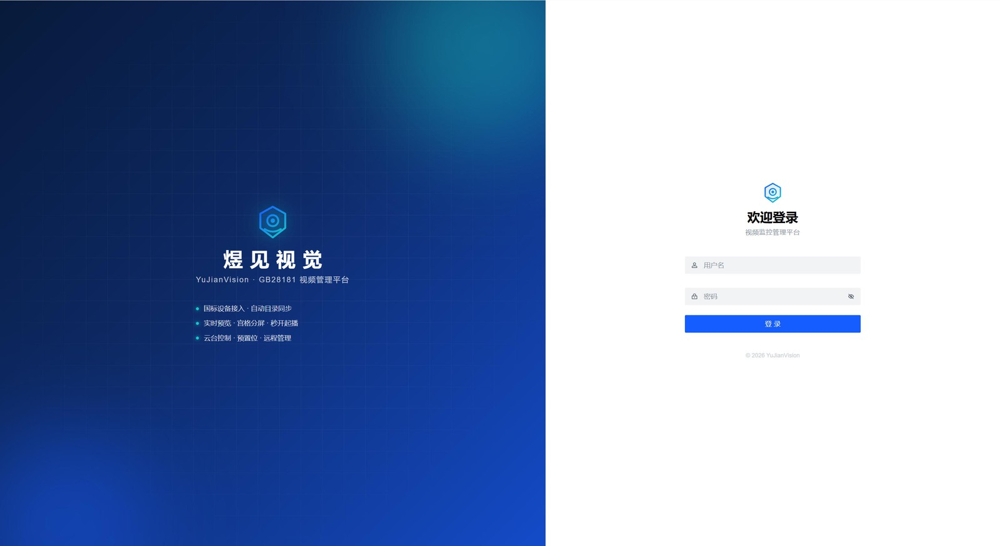
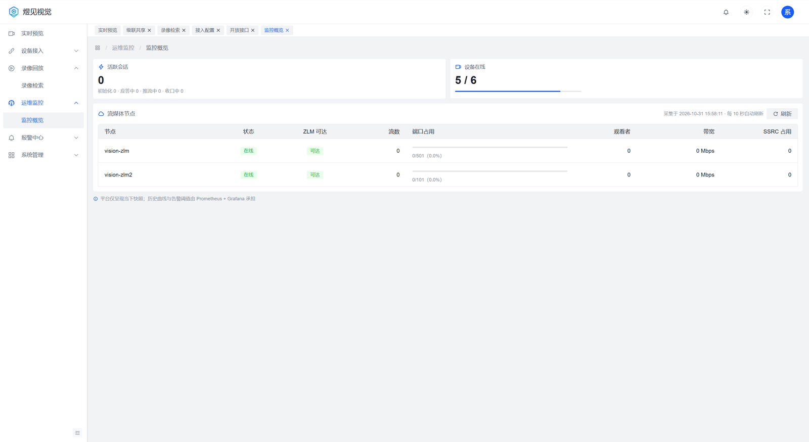

# 部署

两种方式：能装 Docker 就用容器化，一条命令起栈；已有 MySQL/Redis/ZLMediaKit 或不允许 Docker，走裸机 systemd。

## 容器化部署（推荐）

准备：一台 Linux 主机（最低 4C8G，适合小规模；5000 通道 / 200 路并发的压测口径按 8C16G 规划）、Docker 与 compose v2 插件、发行包 `YuJianVision-v1.0.1.zip`。

```bash
unzip -q YuJianVision-v1.0.1.zip
cd v1.0.1

# 放入程序文件
mkdir -p deploy/compose/app/dist
cp app/vision-platform-1.0.1.jar deploy/compose/app/vision-platform.jar
unzip -q app/dist-1.0.1.zip -d /tmp/dist && cp -r /tmp/dist/dist/. deploy/compose/app/dist/

# 起栈（参数填本机对外 IP）
cd deploy/compose && ./setup.sh 192.168.1.10
```

脚本会自动生成全部密钥、起 MySQL/Redis/ZLM/平台/前端、注册媒体节点，结束时打印：

- 访问地址（`http://192.168.1.10:8090`）
- admin 新口令
- 需要放行的端口
- 设备接入参数（SIP 服务器地址等）

浏览器登录后按提示改密。防火墙对用户只放行 8090；设备网段放行 5060 与 30000-30500（tcp+udp）。



登进后先看「运维监控 → 监控概览」：设备在线数、流媒体节点是否都亮绿灯，确认起栈时注册的节点生效。



从源码部署时先构建再执行同样步骤（`web-ui/dist` 默认会打进 jar，见下方说明）：

```bash
cd web-ui && pnpm install && pnpm build
cd ../vision-platform && mvn -DskipTests package
cd ../deploy/compose
mkdir -p app/dist
cp ../../vision-platform/vision-web/target/vision-web.jar app/vision-platform.jar
cp -r ../../web-ui/dist/. app/dist/
./setup.sh 192.168.1.10
```

打包规则：`mvn package` 时若存在 `web-ui/dist`，会自动打进 jar（默认合并部署）；只构建后端、不带前端时加 `-Dembed.web.skip=true`。运行时可用 `vision.webui.embedded=false` 关闭内嵌页面，改由 Nginx 托管。

## 裸机部署（systemd）

适用：机器上已有 MySQL、Redis、ZLMediaKit，或不允许 Docker。

jar 默认内置前端，启动后直接访问 `http://<机器IP>:8082`，不需要单独部署前端；想让 Nginx 托管前端或做 HTTPS 时，再按第 5 步拆出去。

1. 安装 JDK 17（仅支持 17，低版本启动会报 `UnsupportedClassVersionError`；更高版本未验证）。
2. 建库和账号（表结构由平台启动时自动创建）：

   ```bash
   mysql -uroot -p -e "CREATE DATABASE vision_platform DEFAULT CHARSET utf8mb4;
     CREATE USER 'vision'@'%' IDENTIFIED BY '改成你的口令';
     GRANT ALL ON vision_platform.* TO 'vision'@'%';"
   ```

3. 启动 ZLM，按 [部署手册 §3](部署手册.md#3-zlm-配置) 改 `config.ini` 三处。
4. 部署平台：

   ```bash
   mkdir -p /opt/vision/logs /opt/vision/data/snapshot
   cp app/vision-platform-1.0.1.jar /opt/vision/vision-platform.jar
   cp deploy/vision.env.example /opt/vision/vision.env
   vim /opt/vision/vision.env          # 必填项见 docs/配置参考.md
   chmod 600 /opt/vision/vision.env
   cp deploy/vision-platform.service /etc/systemd/system/
   systemctl daemon-reload && systemctl enable --now vision-platform
   curl http://127.0.0.1:8082/actuator/health    # {"status":"UP"}
   ```

5. （可选）拆出前端：把 `dist-1.0.1.zip` 解压到 `/opt/vision/webui/dist`，用 Nginx 提供静态文件并把 `/api`、`/ws` 反代到 8082。跳过此步则直接用 jar 内置页面。
6. 登录平台，确认「流媒体节点」在线，再接入一路设备。

## 下一步

- 完整步骤、升级回滚、故障排查：[部署手册](部署手册.md)
- 环境变量、端口、容量与 HA 参数：[配置参考](../docs/配置参考.md)
- 主备高可用（可选）：[deploy/ha/](ha/)
- 设备接入：[GB28181](../docs/GB28181设备接入指南.md) · [ONVIF](../docs/ONVIF设备接入指南.md) · [拉流代理](../docs/拉流代理接入指南.md)
