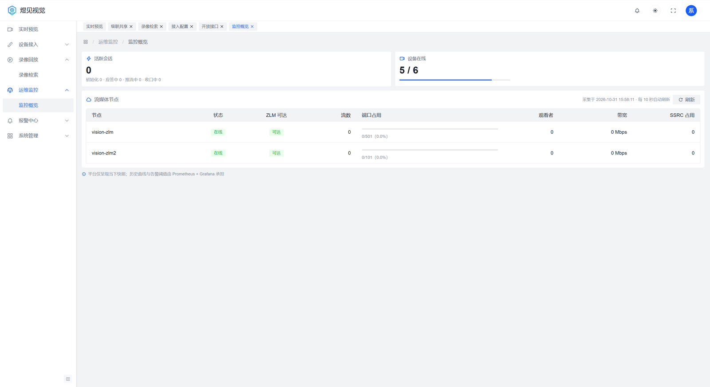

# 部署手册

> **文档导航**：[文档首页](../docs/README.md) · [快速部署](README.md) · [部署手册](部署手册.md) · [配置参考](../docs/配置参考.md) · [GB28181 接入](../docs/GB28181设备接入指南.md) · [ONVIF 接入](../docs/ONVIF设备接入指南.md) · [拉流代理](../docs/拉流代理接入指南.md) · [级联对接](../docs/级联对接指南.md) · [REST-API](../docs/03-REST-API设计.md)

首次部署、升级、排障的完整说明。只想尽快跑起来，先看 [快速部署](README.md)。

## 1. 准备

机器：Linux x86_64。最低 4C8G（小规模，需控制并发）；5000 通道 / 200 路并发的压测口径按 8C16G 规划。系统盘 100G 以上。
软件：Docker 与 compose v2（容器化）、JDK 17（裸机，仅支持 17；更高版本未验证）、Nginx（可选，拆分托管前端时使用）。

需要放行的端口：

| 端口 | 用途 | 开放对象 |
|---|---|---|
| 8090 | 前端入口 | 办公网 / 用户 |
| 8082 | 平台 API（含 `/api/hooks/*` 与 `/actuator/*`） | 前端、运维网段 |
| 5060 tcp+udp | SIP 信令 | 设备与上下级平台网段 |
| 30000-30500 tcp+udp | RTP 收流 | 设备与上下级平台网段 |
| 8081 | ZLM HTTP（播放、Hook 源） | 仅本机/容器内 |
| 554 / 1935 | ZLM RTSP / RTMP | 按需 |

8082、3306、6379 不要对终端网段开放。

## 2. 数据库和 Redis

MySQL 8.0+：建库 `vision_platform`（utf8mb4）和专用账号，平台启动时由 Flyway 自动建表、写入种子菜单与角色，不需要手工执行 SQL。

Redis 6+：单机即可。平台默认用 `REDIS_DB=1`，改成现场没有业务占用的逻辑库。无密码的 Redis 不要设置 `SPRING_DATA_REDIS_PASSWORD`（空串会让连接被拒）。

## 3. ZLM 配置

`config.ini` 必改三处：

1. `mediaServerId` 与平台里节点的 `server_id` 一致（容器化脚本自动注册时用 `vision-zlm`）。
2. 七个 Hook 回调指向平台，地址里显式带 secret：

   ```
   http://<平台IP>:8082/api/hooks/on_publish?secret=<节点secret>
   ```

   回调包括 `on_server_started`、`on_rtp_server_timeout`、`on_stream_changed`、`on_play`、`on_publish`、`on_record_mp4`、`on_snap`。
3. `rtp_proxy.port_range` 与规划一致（默认 30000-30500，段大小等于最大并发收流路数）。

平台启动后到「流媒体节点」确认：`public_ip` 填机器对外 IP（点播 SDP 的 c= 地址用它），平台调用 ZLM API 的地址填 `127.0.0.1`（裸机）或 `zlm`（容器内网）。

## 4. 平台服务

后端以 JDK 17 运行（发行包内 jar 已带前端，直接 `java -jar` 即可，无需再装 Node 或单独铺静态文件）。jar 由本包提供时跳过构建；自行构建时先 `pnpm build` 再 `mvn package`，dist 会自动打进 jar，加 `-Dembed.web.skip=true` 则不带前端。

```bash
mkdir -p /opt/vision/logs /opt/vision/data/snapshot
cp app/vision-platform-1.0.1.jar /opt/vision/vision-platform.jar
cp deploy/vision.env.example /opt/vision/vision.env
chmod 600 /opt/vision/vision.env
cp deploy/vision-platform.service /etc/systemd/system/
systemctl daemon-reload
systemctl enable --now vision-platform
```

`vision.env` 至少填这五项，其余看 [配置参考](../docs/配置参考.md)：MySQL 账号口令、`VISION_JWT_SECRET`、`VISION_AES_KEY`、`VISION_ALERTWEBHOOKTOKEN`、可信代理地址。密钥用 `openssl rand -hex 32` 生成。

服务启动后：

```bash
curl http://127.0.0.1:8082/actuator/health     # {"status":"UP"}
journalctl -u vision-platform -f               # 看 Flyway 建表与启动日志
```

## 5. 前端（可选：拆分托管）

默认用 jar 内置页面，访问 `http://<平台IP>:8082` 即可，本节可跳过。需要 80/443、HTTPS 或独立静态站点时，把 `dist` 解压到 `/opt/vision/webui/dist`，Nginx 按下面三件事配置，并在 `vision.env` 设 `VISION_WEBUI_EMBEDDED=false`：

- 静态文件根目录指向 `dist`，找不到文件时回落到 `index.html`（SPA 路由）；
- `/api` 与 `/ws` 反代到 `http://127.0.0.1:8082`，`/ws` 需要 `Upgrade` 头；
- 若播放走 ZLM 直连，`/rtp/` 反代到 ZLM 的 8081。

更新前端时直接覆盖 `dist` 目录内容，不要删除目录本身（容器或挂载按 inode 识别）。

## 6. 上线自检

1. `curl http://<平台IP>:8082/actuator/health` 返回 UP。
2. 浏览器打开 `http://<平台IP>:8082`（拆分托管时用 Nginx 地址）能出登录页并登录，「设备接入 → 流媒体节点」显示在线（说明 Hook 与 secret 都通）。
3. 「运维监控 → 监控概览」设备在线数与节点状态正常，可作为上线留档：

   

4. 接入一路设备：设备在线 → 通道上线 → 实时预览出画。
5. 按现场设备支持情况验一遍抓图、录像检索、云台控制、对讲。

## 7. 升级与回滚

后端先停再换文件，不要让新 jar 覆盖正在运行的进程：

```bash
systemctl stop vision-platform
cp 新的 vision-platform.jar /opt/vision/vision-platform.jar
systemctl start vision-platform
```

前端随 jar 一起升级：换 jar、重启后刷新浏览器即可。拆分托管时覆盖 `dist` 后刷新浏览器，不需要重启后端。

数据库由 Flyway 自动迁移。升级前先备份：

```bash
mysqldump -uvision -p vision_platform > vision_platform_$(date +%F).sql
```

回滚 = 还原数据库备份 + 换回旧 jar。菜单结构改动的版本要求后端和前端同一窗口升级，否则旧前端会出现空白菜单。

容器化形态把上面三步换成 `docker compose stop platform`、复制 jar、`docker compose up -d platform`；前端覆盖后 `docker compose restart webui`。

## 8. 主备高可用（可选）

单机双实例形态：两个平台进程同机运行，Redis 租约决定谁是活跃实例，keepalived 负责健康检测与切换，SIP 栈在实例间接管。文件在 [ha/](ha/)，步骤：

1. 复制 `ha/vision-standby.env.example` 为 `/opt/vision/vision-standby.env`，按注释填与主实例不同的四项（`SERVER_ADDRESS`、`VISION_HA_ROLE=standby`、`VISION_SIP_AUTOSTART=false`、`VISION_HA_PEER_BASE_URL`）。
2. 备实例 jar 放 `/opt/vision/vision-platform-standby.jar`，单元文件复制到 `/etc/systemd/system/`。
3. 两个实例的 `vision.env` 加上 `VISION_HA_ENABLED=true`、`VISION_HA_TOKEN`（两实例同值）。
4. 按 `ha/` 注释安装 keepalived，启用 `keepalived-vision.service`。
5. 验证：停止主实例，备实例应在几秒内接管 SIP，站点点播不中断超过一个 INVITE 周期；重启主实例后自动回切。

不配置 `VISION_HA_ENABLED` 时行为与单机完全一致，可以随时关闭。

## 9. 常见故障

**启动失败，日志提示密钥不合规**
`VISION_JWT_SECRET` 或 `VISION_AES_KEY` 缺失、长度不足、仍是模板占位值。生产环境会直接拒绝启动，换成 `openssl rand -hex 32` 生成的值。

**启动失败，连不上 MySQL**
检查 `MYSQL_USERNAME`/`MYSQL_PASSWORD` 与建库账号是否一致，账号是否有 `vision_platform.*` 权限。容器化形态还要确认 mysql 容器健康后再起 platform。

**登录后客户端 IP 全是同一个地址**
可信代理没配。把 Nginx/webui 容器到平台的源地址加入 `VISION_SECURITY_TRUSTEDPROXIES_0`，容器重建后 IP 可能变化，需要重新确认。

**设备注册不上（5060 无包）**
依次确认：防火墙放行 5060 tcp+udp、设备侧 SIP 服务器地址与端口、SIP 域和编码与平台一致、平台日志是否收到 REGISTER。

**节点显示离线，但 ZLM 正常**
Hook 地址里的 `secret` 与平台节点配置不一致，或平台 IP 写错。容器内网要写服务名，裸机写宿主 IP。

**能点播但没有画面**
检查 ZLM 的 `public_ip` 是否为机器对外 IP，播放地址是否可达（防火墙、NAT）。

**前端 403 或白屏**
`dist` 目录被删除后重建，容器看到的是已删除的 inode。恢复：把文件解压回原目录，或重启容器。

**Cloud 录像或抓图报 1013**
截图目录不可写或不存在。确认 `VISION_SNAPSHOT_DIR` 已创建且运行用户可写。
