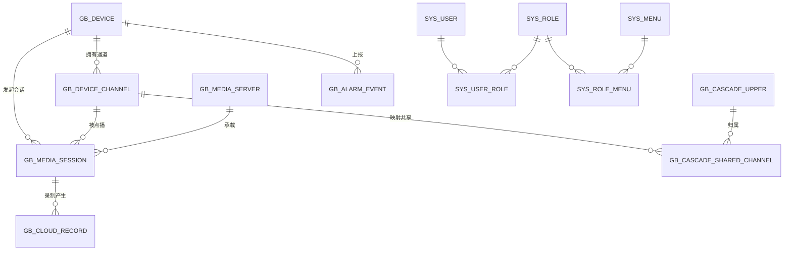

# 02 数据库设计

> **文档导航**：[文档首页](README.md) · [快速部署](../deploy/README.md) · [部署手册](../deploy/部署手册.md) · [配置参考](配置参考.md) · [GB28181 接入](GB28181设备接入指南.md) · [ONVIF 接入](ONVIF设备接入指南.md) · [拉流代理](拉流代理接入指南.md) · [级联对接](级联对接指南.md) · [REST-API](03-REST-API设计.md) · [OpenAPI 对接](16-OpenAPI对接手册.md) · [数据库设计](02-数据库设计.md)

> MySQL 8.0，utf8mb4，InnoDB。`gb_` 前缀为业务表，`sys_` 为平台表。
> 标注 [M1]/[M2]/[M3] 表示该表首次交付的迭代；[预留] 表示本期不实现、结构先行。

## 0. 全局约定

| 约定 | 说明 |
|---|---|
| **租户字段** | 所有业务表（gb_* / sys_*）统一增加 `tenant_id BIGINT NOT NULL DEFAULT 0`（DDL 中不再逐一展示）；v1 单域固定 0，由 MyBatis-Plus 租户插件统一注入查询条件（决策 D12） |
| **软删除** | `gb_device`、`gb_device_channel`、`gb_group`、`sys_user`、`sys_menu` 增加 `deleted_time DATETIME NULL`（NULL=有效，删除=置时间戳）。唯一索引统一按 `(业务唯一键, deleted_time)` 建立（NULL 可重复），避免"删后重建"冲突；下文 DDL 中的唯一索引按原业务键展示，实施时按此规则调整 |
| **时区** | 平台/DB/Java 统一 Asia/Shanghai（决策 D15）；SDP `t=`（epoch）与 XML 本地时间在边界显式转换；设备接入时记录 `gb_device.time_diff_ms` 作为回放校时提示依据 |
| **敏感字段** | `gb_device.password`、`gb_cascade_upper.password`、`open_app.app_secret`、`gb_media_server.sign_secret` 为 AES 可逆加密存储（Digest 计算需要明文），密钥走配置中心/环境变量，不入库不入代码。**M1-10 实现口径**：AES-256-GCM，密文格式 `enc:v1:{Base64(iv12B‖ct‖tag16B)}`，密钥=`vision.security.aes.key`（SHA-256 派生，prod 弱默认拒绝启动）；明文兼容读取、启动 sweep 一次性加密存量（M1 已落地 device.password/sign_secret；**M3-B1 起级联 gb_cascade_upper.password 同口径接入**——加密存量/旧密钥轮换/失败跳过三分支与设备表一致；open_app 随后续里程碑实现）。**密钥轮换（M2 收口）**：可选 `VISION_AES_OLD_KEY` 临时注入旧密钥，启动扫描把存量旧密钥密文逐条迁移到当前密钥（当前密钥可解=不动/仅旧密钥可解=重加密回写/均不可解=跳过不动数据），幂等可重复；运维步骤 deploy/README §5.1，平时不配置=功能不启用。**软删死行回收（M2 收口追加）**：SoftDeletePurgeTask 每日 02:50 把 deleted_time 超过保留期（`vision.retention.soft-delete-days` 默认 30）的死行物理删除，覆盖 gb_device/gb_device_channel/gb_group/sys_user（含 sys_user_role 残留引用） |
| **字典** | 展示/分类类枚举入 `sys_dict`（可维护、标准接口获取）；流程状态类（会话状态等）由代码枚举控制，不入字典（决策 D16） |

## 1. ER 概览



## 2. DDL

### 2.1 gb_device — GB28181 设备 / 下级平台 [M1]

```sql
CREATE TABLE gb_device (
  id                  BIGINT UNSIGNED AUTO_INCREMENT PRIMARY KEY,
  device_id           VARCHAR(50)  NOT NULL COMMENT '国标20位设备编码(SIP用户名)',
  name                VARCHAR(128) DEFAULT '' COMMENT '设备名称(注册上报)',
  device_type         TINYINT      NOT NULL DEFAULT 1 COMMENT '1:设备(IPC/NVR) 2:下级平台(M3)',
  protocol_version    VARCHAR(8)   NOT NULL DEFAULT '2016' COMMENT '协议版本 2016/2022',
  manufacturer        VARCHAR(64)  DEFAULT '',
  model               VARCHAR(64)  DEFAULT '',
  firmware            VARCHAR(64)  DEFAULT '' COMMENT '固件版本',
  transport           VARCHAR(8)   DEFAULT 'UDP' COMMENT '信令传输 UDP/TCP',
  password            VARCHAR(255) DEFAULT '' COMMENT '接入密码(Digest认证,AES加密存储,V6由128扩容)',
  time_diff_ms        INT          DEFAULT 0 COMMENT '设备时间与平台偏差(毫秒),回放前校时提示依据',
  expires             INT          DEFAULT 3600 COMMENT '注册有效期(秒)',
  heartbeat_interval  INT          DEFAULT 60 COMMENT '心跳周期(秒)',
  heartbeat_timeout   INT          DEFAULT 3  COMMENT '心跳超时次数(判离线)',
  media_tcp_mode      TINYINT      DEFAULT 1 COMMENT '默认收流方式 1:TCP被动 0:UDP',
  ip                  VARCHAR(64)  DEFAULT '' COMMENT '注册联系地址IP',
  port                INT          DEFAULT 5060,
  host_ip             VARCHAR(64)  DEFAULT '' COMMENT '实际来源IP(NAT后)',
  online              TINYINT      DEFAULT 0 COMMENT '0离线 1在线',
  register_time       DATETIME     DEFAULT NULL,
  keepalive_time      DATETIME     DEFAULT NULL,
  offline_time        DATETIME     DEFAULT NULL,
  create_time         DATETIME     DEFAULT CURRENT_TIMESTAMP,
  update_time         DATETIME     DEFAULT CURRENT_TIMESTAMP ON UPDATE CURRENT_TIMESTAMP,
  UNIQUE KEY uk_device_id (device_id)
) COMMENT 'GB28181设备/下级平台';
```

### 2.2 gb_device_channel — 通道目录 [M1]

```sql
CREATE TABLE gb_device_channel (
  id                BIGINT UNSIGNED AUTO_INCREMENT PRIMARY KEY,
  device_db_id      BIGINT UNSIGNED NOT NULL COMMENT '所属设备gb_device.id',
  channel_id        VARCHAR(50)  NOT NULL COMMENT '国标20位通道编码',
  name              VARCHAR(128) DEFAULT '' COMMENT '设备上报名称',
  custom_name       VARCHAR(128) DEFAULT '' COMMENT '平台自定义名称(展示优先)',
  manufacturer      VARCHAR(64)  DEFAULT '',
  model             VARCHAR(64)  DEFAULT '',
  owner             VARCHAR(64)  DEFAULT '',
  civil_code        VARCHAR(64)  DEFAULT '' COMMENT '行政区划',
  address           VARCHAR(128) DEFAULT '',
  parental          TINYINT      DEFAULT 0 COMMENT '1:有子节点(虚拟分组)',
  parent_id         VARCHAR(50)  DEFAULT '' COMMENT '父节点通道编码',
  business_group_id VARCHAR(50)  DEFAULT '' COMMENT '业务分组编码',
  status            TINYINT      DEFAULT 1 COMMENT '通道状态 1:ON 0:OFF',
  register_way      TINYINT      DEFAULT 1,
  secrecy           TINYINT      DEFAULT 0,
  ip                VARCHAR(64)  DEFAULT '',
  port              INT          DEFAULT 0,
  longitude         DECIMAL(10,6) DEFAULT NULL,
  latitude          DECIMAL(10,6) DEFAULT NULL,
  ptz_type          TINYINT      DEFAULT 0 COMMENT '0:无PTZ 1:球机 2:半球 3:固定枪机 4:遥控 5:不支持',
  ptz_enabled       TINYINT      DEFAULT NULL COMMENT '云台开关(V12/B3): NULL=按ptzType自动 1=强制开启(设备未上报也允许控) 0=禁用(上报了也拒)',
  mobile            TINYINT      DEFAULT 0 COMMENT '1:移动设备(支持位置订阅)',
  sub_count         INT          DEFAULT 0 COMMENT '子节点数',
  catalog_time      DATETIME     DEFAULT NULL COMMENT '最近一次目录同步时间',
  create_time       DATETIME     DEFAULT CURRENT_TIMESTAMP,
  update_time       DATETIME     DEFAULT CURRENT_TIMESTAMP ON UPDATE CURRENT_TIMESTAMP,
  UNIQUE KEY uk_dev_ch (device_db_id, channel_id),
  KEY idx_channel_id (channel_id),
  KEY idx_parent (device_db_id, parent_id)
) COMMENT '通道目录';
```

### 2.3 gb_media_server — ZLM 节点 [M1]

```sql
CREATE TABLE gb_media_server (
  id             BIGINT UNSIGNED AUTO_INCREMENT PRIMARY KEY,
  server_id      VARCHAR(64) NOT NULL COMMENT '节点标识(自定,ZLM general.streamNoneReaderMsgServerId)',
  host_ip        VARCHAR(64) NOT NULL COMMENT '内网/平台可达IP',
  public_ip      VARCHAR(64) NOT NULL COMMENT '设备可达IP(点播SDP c=行使用)',
  http_port      INT         DEFAULT 80,
  http_ssl_port  INT         DEFAULT 443,
  rtsp_port      INT         DEFAULT 554,
  rtmp_port      INT         DEFAULT 1935,
  rtc_port       INT         DEFAULT 8000,
  rtp_port_start INT         DEFAULT 30000 COMMENT 'RTP接收端口段起',
  rtp_port_end   INT         DEFAULT 30500 COMMENT 'RTP接收端口段止',
  hook_enable    TINYINT     DEFAULT 1,
  sign_secret    VARCHAR(255) DEFAULT '' COMMENT '播放URL签名密钥(每节点独立,AES存储可轮换,V6由64扩容)',
  zlm_version    VARCHAR(32) DEFAULT '' COMMENT 'ZLM版本(on_server_started更新)',
  status         TINYINT     DEFAULT 0 COMMENT '0离线 1在线(on_server_keepalive判定)',
  stream_count   INT         DEFAULT 0 COMMENT '当前流数(定时对账刷新)',
  create_time    DATETIME    DEFAULT CURRENT_TIMESTAMP,
  update_time    DATETIME    DEFAULT CURRENT_TIMESTAMP ON UPDATE CURRENT_TIMESTAMP,
  UNIQUE KEY uk_server_id (server_id)
) COMMENT 'ZLM流媒体节点';
```

### 2.4 gb_media_session — 媒体会话（点播/回放） [M1]

```sql
CREATE TABLE gb_media_session (
  id             BIGINT UNSIGNED AUTO_INCREMENT PRIMARY KEY,
  session_type   TINYINT      NOT NULL COMMENT '1:实况 2:回放 3:下载 4:对讲 5:级联转发(M3)',
  audio_stream_id VARCHAR(128) DEFAULT NULL COMMENT '对讲音频源流ID(预留列V22, 当前实现平台直推不经ZLM)',
  audio_port     INT          DEFAULT NULL COMMENT '对讲音频源收流端口(预留列V22)',
  stream_id      VARCHAR(128) NOT NULL COMMENT 'ZLM streamId',
  app            VARCHAR(32)  DEFAULT 'rtp',
  device_db_id   BIGINT UNSIGNED NOT NULL,
  channel_db_id  BIGINT UNSIGNED NOT NULL,
  device_id      VARCHAR(50)  NOT NULL COMMENT '国标编码(冗余,便于查询)',
  channel_id     VARCHAR(50)  NOT NULL,
  server_id      VARCHAR(64)  NOT NULL COMMENT '承载节点',
  ssrc           VARCHAR(16)  NOT NULL COMMENT '10位十进制SSRC',
  tcp_mode       TINYINT      DEFAULT 1 COMMENT '1:TCP被动 0:UDP',
  stream_profile TINYINT      DEFAULT 1 COMMENT '码流 1:主码流 2:子码流',
  rtp_port       INT          DEFAULT 0 COMMENT 'ZLM分配的收流端口',
  call_id        VARCHAR(96)  DEFAULT '' COMMENT 'SIP CallID',
  user_id        BIGINT       DEFAULT NULL COMMENT '发起用户(审计)',
  upper_id       BIGINT       DEFAULT NULL COMMENT '级联上级id(session_type=5时关联gb_cascade_upper)',
  status         VARCHAR(16)  NOT NULL DEFAULT 'INIT' COMMENT 'INIT/INVITING/STREAMING/CLOSING/CLOSED/FAILED/CANCELLED',
  active_flag    TINYINT GENERATED ALWAYS AS (IF(status IN ('INIT','INVITING','STREAMING','CLOSING'),1,NULL)) STORED COMMENT '活跃标记生成列(活跃非空,配合唯一约束防并发双开流)',
  viewer_count   INT          DEFAULT 0 COMMENT '观看者引用计数',
  stop_reason    VARCHAR(32)  DEFAULT '' COMMENT 'user_stop/none_reader/device_offline/stream_lost/invite_timeout/invite_rejected/no_stream/platform_restart/cascade_bye/device_bye(M1-10 补录,设备主动 BYE)',
  invite_time    DATETIME     DEFAULT NULL,
  start_time     DATETIME     DEFAULT NULL COMMENT '流就绪时间',
  stop_time      DATETIME     DEFAULT NULL,
  error_msg      VARCHAR(255) DEFAULT '',
  create_time    DATETIME     DEFAULT CURRENT_TIMESTAMP,
  update_time    DATETIME     DEFAULT CURRENT_TIMESTAMP ON UPDATE CURRENT_TIMESTAMP,
  KEY idx_call_id (call_id),
  KEY idx_stream (stream_id),
  KEY idx_channel (channel_db_id, session_type, status),
  KEY idx_status (status),
  UNIQUE KEY uk_active (channel_db_id, stream_profile, active_flag),
  KEY idx_stop (stop_time)
) COMMENT '媒体会话';
```

### 2.5 gb_cloud_record — 云端录像 [M2]

```sql
CREATE TABLE gb_cloud_record (
  id           BIGINT UNSIGNED AUTO_INCREMENT PRIMARY KEY,
  server_id    VARCHAR(64)  NOT NULL COMMENT '落盘节点',
  app          VARCHAR(32)  DEFAULT 'rtp',
  stream_id    VARCHAR(128) NOT NULL,
  device_id    VARCHAR(50)  DEFAULT '',
  channel_db_id BIGINT UNSIGNED DEFAULT NULL COMMENT '通道id(归因主键)',
  channel_id   VARCHAR(50)  DEFAULT '' COMMENT '国标编码(冗余)',
  file_path    VARCHAR(512) NOT NULL COMMENT '文件相对路径',
  file_name    VARCHAR(255) DEFAULT '',
  file_size    BIGINT       DEFAULT 0 COMMENT '字节',
  duration     INT          DEFAULT 0 COMMENT '秒',
  start_time   DATETIME     DEFAULT NULL,
  end_time     DATETIME     DEFAULT NULL,
  upload_state TINYINT      DEFAULT 0 COMMENT '0:本地 1:已上传对象存储(M2可选)',
  create_time  DATETIME     DEFAULT CURRENT_TIMESTAMP,
  KEY idx_ch_time (channel_db_id, start_time),
  KEY idx_end (end_time)
) COMMENT '云端录像(服务端MP4落盘)';
```

### 2.6 gb_record_item — 录像检索结果缓存 [M2，可选]

```sql
CREATE TABLE gb_record_item (
  id          BIGINT UNSIGNED AUTO_INCREMENT PRIMARY KEY,
  device_db_id BIGINT UNSIGNED NOT NULL,
  channel_db_id BIGINT UNSIGNED NOT NULL,
  name        VARCHAR(255) DEFAULT '',
  start_time  DATETIME NOT NULL,
  end_time    DATETIME NOT NULL,
  record_type VARCHAR(16) DEFAULT 'time' COMMENT 'time/alarm/manual',
  query_key   VARCHAR(64) DEFAULT '' COMMENT '查询批次(通道+起止)缓存键',
  create_time DATETIME DEFAULT CURRENT_TIMESTAMP,
  KEY idx_ch (channel_db_id, start_time),
  KEY idx_query (query_key)
) COMMENT 'RecordInfo检索结果(收敛合并后)。注:也可仅用Redis缓存,TTL 5分钟';
```

### 2.7 gb_cascade_upper — 上级平台配置（本平台作为下级） [M3]

```sql
CREATE TABLE gb_cascade_upper (
  id                  BIGINT UNSIGNED AUTO_INCREMENT PRIMARY KEY,
  name                VARCHAR(128) NOT NULL COMMENT '上级平台名称',
  upper_device_id     VARCHAR(50)  NOT NULL COMMENT '上级平台国标编码',
  local_device_id     VARCHAR(50)  NOT NULL COMMENT '本平台在上级侧的国标编码',
  upper_ip            VARCHAR(64)  NOT NULL,
  upper_port          INT          NOT NULL DEFAULT 5060,
  password            VARCHAR(255) DEFAULT '' COMMENT 'AES 密文(密文列宽同 gb_device.password, V6 教训)',
  transport           VARCHAR(8)   DEFAULT 'UDP',
  expires             INT          DEFAULT 3600,
  keepalive_interval  INT          DEFAULT 60,
  catalog_mode        TINYINT      DEFAULT 1 COMMENT '目录上报 1:仅共享通道 2:全部通道',
  auto_push_catalog   TINYINT      DEFAULT 0 COMMENT '目录变化时主动通知上级',
  ptz_forward         TINYINT      DEFAULT 1 COMMENT '上级云台指令透传到本平台设备',
  status              TINYINT      DEFAULT 0 COMMENT '0未启用 1启用',
  online              TINYINT      DEFAULT 0 COMMENT '上级注册状态',
  register_time       DATETIME     DEFAULT NULL,
  create_time         DATETIME     DEFAULT CURRENT_TIMESTAMP,
  update_time         DATETIME     DEFAULT CURRENT_TIMESTAMP ON UPDATE CURRENT_TIMESTAMP
) COMMENT '上级平台(本平台作为下级注册)';
```

### 2.8 gb_cascade_shared_channel — 级联共享通道 [M3]

```sql
CREATE TABLE gb_cascade_shared_channel (
  id                BIGINT UNSIGNED AUTO_INCREMENT PRIMARY KEY,
  upper_id          BIGINT UNSIGNED NOT NULL COMMENT 'gb_cascade_upper.id',
  channel_db_id     BIGINT UNSIGNED NOT NULL COMMENT '本平台通道id',
  virtual_device_id VARCHAR(50)  DEFAULT '' COMMENT '映射给上级的虚拟编码(空=用原编码)',
  enabled           TINYINT      DEFAULT 1,
  create_time       DATETIME     DEFAULT CURRENT_TIMESTAMP,
  UNIQUE KEY uk_upper_ch (upper_id, channel_db_id)
) COMMENT '共享给上级的通道';
```

### 2.9 gb_alarm_event — 报警事件 [M3]

```sql
CREATE TABLE gb_alarm_event (
  id                BIGINT UNSIGNED AUTO_INCREMENT PRIMARY KEY,
  device_db_id      BIGINT UNSIGNED NOT NULL,
  channel_db_id     BIGINT UNSIGNED DEFAULT NULL,
  device_id         VARCHAR(50) NOT NULL,
  channel_id        VARCHAR(50) DEFAULT '',
  alarm_method      TINYINT     DEFAULT 1 COMMENT '1:电话 2:短信 3:视频 4:设备联网 5:图片 6:人工',
  alarm_type        INT         DEFAULT 1 COMMENT '报警依据类型(国标表)',
  alarm_priority    TINYINT     DEFAULT 1 COMMENT '1一级 2二级 3三级 4四级',
  alarm_time        DATETIME    DEFAULT NULL,
  description       VARCHAR(512) DEFAULT '',
  snap_path         VARCHAR(512) DEFAULT '' COMMENT '报警图片路径(设备/上级附带)',
  longitude         DECIMAL(10,6) DEFAULT NULL,
  latitude          DECIMAL(10,6) DEFAULT NULL,
  handled           TINYINT     DEFAULT 0,
  handle_time       DATETIME    DEFAULT NULL,
  handle_user       BIGINT      DEFAULT NULL,
  create_time       DATETIME    DEFAULT CURRENT_TIMESTAMP,
  KEY idx_time (alarm_time),
  KEY idx_dev (device_db_id, alarm_time)
) COMMENT '报警事件';
```

### 2.10 sys_user / sys_role / 菜单权限 [M1]

```sql
CREATE TABLE sys_user (
  id           BIGINT UNSIGNED AUTO_INCREMENT PRIMARY KEY,
  username     VARCHAR(64)  NOT NULL,
  password     VARCHAR(128) NOT NULL COMMENT 'BCrypt',
  nickname     VARCHAR(64)  DEFAULT '',
  status       TINYINT DEFAULT 1,
  last_login   DATETIME DEFAULT NULL,
  create_time  DATETIME DEFAULT CURRENT_TIMESTAMP,
  update_time  DATETIME DEFAULT CURRENT_TIMESTAMP ON UPDATE CURRENT_TIMESTAMP,
  UNIQUE KEY uk_username (username)
) COMMENT '系统用户';

CREATE TABLE sys_role (
  id          BIGINT UNSIGNED AUTO_INCREMENT PRIMARY KEY,
  role_code   VARCHAR(64) NOT NULL,
  role_name   VARCHAR(64) NOT NULL,
  remark      VARCHAR(255) DEFAULT '',
  data_scope  TINYINT DEFAULT 1 COMMENT '数据范围(V12/B3): 1=全部通道 2=按分组授权; admin 解析时恒短路为全部, 不依赖本字段',
  UNIQUE KEY uk_role_code (role_code)
) COMMENT '角色(admin/operator/viewer 内置)';

-- 通道级数据授权（B3, M2 #5）: data_scope=2 时生效
CREATE TABLE sys_role_group (
  id          BIGINT UNSIGNED AUTO_INCREMENT PRIMARY KEY,
  role_id     BIGINT UNSIGNED NOT NULL,
  group_id    BIGINT UNSIGNED NOT NULL COMMENT 'gb_group.id, 子树经 ancestors 展开',
  create_time DATETIME DEFAULT CURRENT_TIMESTAMP,
  UNIQUE KEY uk_role_grp (role_id, group_id)
) COMMENT '角色-分组数据授权';

CREATE TABLE sys_role_channel (
  id            BIGINT UNSIGNED AUTO_INCREMENT PRIMARY KEY,
  role_id       BIGINT UNSIGNED NOT NULL,
  channel_db_id BIGINT UNSIGNED NOT NULL COMMENT 'gb_device_channel.id',
  create_time   DATETIME DEFAULT CURRENT_TIMESTAMP,
  UNIQUE KEY uk_role_ch (role_id, channel_db_id)
) COMMENT '角色-通道直选授权(B3 预留: 授权粒度=分组, 通道直选挂后续批次; 保存数据授权时清空)';

CREATE TABLE sys_user_role (
  user_id BIGINT UNSIGNED NOT NULL,
  role_id BIGINT UNSIGNED NOT NULL,
  PRIMARY KEY (user_id, role_id)
);

-- 菜单-按钮权限一体化模型（决策 D11）: 目录/菜单/按钮统一建模, 按钮权限即 menu_type=3 记录上的 perm_code
CREATE TABLE sys_menu (
  id          BIGINT UNSIGNED AUTO_INCREMENT PRIMARY KEY,
  parent_id   BIGINT UNSIGNED DEFAULT 0 COMMENT '父菜单id, 0=根',
  menu_name   VARCHAR(64)  NOT NULL,
  menu_type   TINYINT      NOT NULL COMMENT '1:目录 2:菜单 3:按钮',
  path        VARCHAR(128) DEFAULT '' COMMENT '路由路径(目录/菜单)',
  component   VARCHAR(255) DEFAULT '' COMMENT '前端组件路径(菜单)',
  perm_code   VARCHAR(128) DEFAULT '' COMMENT '权限标识, 如 device:play / ptz:control / device:delete',
  icon        VARCHAR(64)  DEFAULT '',
  sort_order  INT          DEFAULT 0,
  visible     TINYINT      DEFAULT 1,
  status      TINYINT      DEFAULT 1 COMMENT '1启用 0停用',
  create_time DATETIME DEFAULT CURRENT_TIMESTAMP,
  update_time DATETIME DEFAULT CURRENT_TIMESTAMP ON UPDATE CURRENT_TIMESTAMP,
  KEY idx_parent (parent_id)
) COMMENT '菜单与按钮权限';

CREATE TABLE sys_role_menu (
  role_id BIGINT UNSIGNED NOT NULL,
  menu_id BIGINT UNSIGNED NOT NULL,
  PRIMARY KEY (role_id, menu_id)
) COMMENT '角色-菜单(含按钮)授权';
```

### 2.11 sys_oper_log — 操作日志 [M1]

```sql
CREATE TABLE sys_oper_log (
  id          BIGINT UNSIGNED AUTO_INCREMENT PRIMARY KEY,
  user_id     BIGINT       DEFAULT NULL,
  username    VARCHAR(64)  DEFAULT '',
  module      VARCHAR(32)  DEFAULT '' COMMENT 'device/play/playback/ptz/cascade/sys',
  operation   VARCHAR(64)  DEFAULT '',
  biz_type    VARCHAR(32)  DEFAULT '' COMMENT '业务对象类型: device/channel/group/cascade/user',
  biz_id      VARCHAR(64)  DEFAULT '' COMMENT '业务对象id(支撑"按对象查操作历史")',
  detail      VARCHAR(1024) DEFAULT '',
  client_ip   VARCHAR(64)  DEFAULT '',
  cost_ms     INT          DEFAULT 0,
  result      TINYINT      DEFAULT 1 COMMENT '1成功 0失败',
  create_time DATETIME     DEFAULT CURRENT_TIMESTAMP,
  KEY idx_user (user_id, create_time),
  KEY idx_module (module, create_time)
) COMMENT '操作日志';
```

### 2.12 gb_group / gb_group_channel_ref — 自定义分组（平台主树） [M1]

```sql
CREATE TABLE gb_group (
  id            BIGINT UNSIGNED AUTO_INCREMENT PRIMARY KEY,
  parent_id     BIGINT UNSIGNED DEFAULT 0 COMMENT '父节点, 0=根',
  ancestors     VARCHAR(255) DEFAULT '' COMMENT '祖级路径(如 0,1,5), 便于子树查询',
  group_name    VARCHAR(128) NOT NULL,
  sort_order    INT          DEFAULT 0,
  create_time   DATETIME DEFAULT CURRENT_TIMESTAMP,
  update_time   DATETIME DEFAULT CURRENT_TIMESTAMP ON UPDATE CURRENT_TIMESTAMP,
  KEY idx_parent (parent_id)
) COMMENT '自定义分组(决策D13: 作为前端主树, 国标Catalog目录为原始视图)';

CREATE TABLE gb_group_channel_ref (
  id            BIGINT UNSIGNED AUTO_INCREMENT PRIMARY KEY,
  group_id      BIGINT UNSIGNED NOT NULL,
  channel_db_id BIGINT UNSIGNED NOT NULL,
  create_time   DATETIME DEFAULT CURRENT_TIMESTAMP,
  UNIQUE KEY uk_grp_ch (group_id, channel_db_id),
  KEY idx_channel (channel_db_id)
) COMMENT '分组-通道多对多表结构(应用层约束: 同一通道仅可属一个分组, M2-B3 修订)';
```

### 2.13 gb_record_plan — 云端录像计划 [M2]

```sql
CREATE TABLE gb_record_plan (
  id            BIGINT UNSIGNED AUTO_INCREMENT PRIMARY KEY,
  name          VARCHAR(128) NOT NULL,
  plan_type     TINYINT      DEFAULT 1 COMMENT '1:全局默认 2:通道',
  channel_db_id BIGINT UNSIGNED DEFAULT NULL COMMENT 'plan_type=2 时必填',
  week_plan     JSON         DEFAULT NULL COMMENT '7×48半小时布尔矩阵(周一~周日)',
  enable        TINYINT      DEFAULT 1,
  create_time   DATETIME DEFAULT CURRENT_TIMESTAMP,
  update_time   DATETIME DEFAULT CURRENT_TIMESTAMP ON UPDATE CURRENT_TIMESTAMP,
  KEY idx_channel (channel_db_id)
) COMMENT '录像计划';
```

### 2.14 gb_device_position — 移动设备位置轨迹 [M3]

```sql
CREATE TABLE gb_device_position (
  id            BIGINT UNSIGNED AUTO_INCREMENT PRIMARY KEY,
  device_db_id  BIGINT UNSIGNED NOT NULL,
  channel_db_id BIGINT UNSIGNED DEFAULT NULL,
  time          DATETIME NOT NULL,
  longitude     DECIMAL(10,6) DEFAULT NULL,
  latitude      DECIMAL(10,6) DEFAULT NULL,
  altitude      DECIMAL(8,2)  DEFAULT NULL,
  speed         DECIMAL(8,2)  DEFAULT NULL,
  direction     DECIMAL(6,2)  DEFAULT NULL,
  create_time   DATETIME DEFAULT CURRENT_TIMESTAMP,
  KEY idx_ch_time (channel_db_id, time)
) COMMENT '位置轨迹(MobilePosition订阅)。按月分区, 保留90天, 归档任务清理';
```

### 2.15 gb_session_viewer — 观看者明细 [M2，可选]

```sql
CREATE TABLE gb_session_viewer (
  id           BIGINT UNSIGNED AUTO_INCREMENT PRIMARY KEY,
  session_id   BIGINT UNSIGNED NOT NULL,
  user_id      BIGINT UNSIGNED NOT NULL,
  enter_time   DATETIME DEFAULT CURRENT_TIMESTAMP,
  refresh_time DATETIME DEFAULT NULL,
  UNIQUE KEY uk_session_user (session_id, user_id),
  KEY idx_user (user_id)
) COMMENT '会话观看者明细(会话页"谁在看"/审计)';
```

### 2.16 sys_dict_type / sys_dict_data — 公共字典 [M1]

```sql
CREATE TABLE sys_dict_type (
  id         BIGINT UNSIGNED AUTO_INCREMENT PRIMARY KEY,
  dict_type  VARCHAR(64)  NOT NULL COMMENT '类型编码: device_type/ptz_type/alarm_type/alarm_priority/stop_reason/notice_type/manufacturer...',
  dict_name  VARCHAR(64)  NOT NULL,
  builtin    TINYINT      DEFAULT 0 COMMENT '1系统内置(不可删除)',
  remark     VARCHAR(255) DEFAULT '',
  create_time DATETIME DEFAULT CURRENT_TIMESTAMP,
  UNIQUE KEY uk_type (dict_type)
) COMMENT '字典类型(决策D16)';

CREATE TABLE sys_dict_data (
  id         BIGINT UNSIGNED AUTO_INCREMENT PRIMARY KEY,
  dict_type  VARCHAR(64)  NOT NULL,
  dict_value VARCHAR(64)  NOT NULL COMMENT '存储值(与后端枚举code对齐)',
  dict_label VARCHAR(128) NOT NULL COMMENT '显示名称',
  extra      VARCHAR(255) DEFAULT '' COMMENT '扩展JSON(颜色/图标等)',
  sort_order INT          DEFAULT 0,
  status     TINYINT      DEFAULT 1,
  UNIQUE KEY uk_type_value (dict_type, dict_value)
) COMMENT '字典数据(标准接口: GET /api/dicts/{dictType})';
```

> 分层原则：展示/分类类枚举入库可维护；**流程状态类（会话状态等驱动逻辑的值）由代码枚举控制，不提供字典维护入口**，防止运营改动破坏状态机。

### 2.17 sys_notice / sys_user_message — 站内消息 [M2]

```sql
CREATE TABLE sys_notice (
  id           BIGINT UNSIGNED AUTO_INCREMENT PRIMARY KEY,
  title        VARCHAR(128) NOT NULL,
  content      VARCHAR(1024) DEFAULT '',
  notice_type  VARCHAR(32)  DEFAULT '' COMMENT 'device_offline/alarm/catalog_fail/sys',
  level        TINYINT      DEFAULT 1 COMMENT '1提示 2重要 3紧急',
  target_scope TINYINT      DEFAULT 0 COMMENT '0全员 1指定角色',
  create_time  DATETIME DEFAULT CURRENT_TIMESTAMP,
  KEY idx_time (create_time)
) COMMENT '站内消息(设备离线/报警/目录同步失败等, 与WS推送双通道)';

CREATE TABLE sys_user_message (
  id        BIGINT UNSIGNED AUTO_INCREMENT PRIMARY KEY,
  user_id   BIGINT UNSIGNED NOT NULL,
  notice_id BIGINT UNSIGNED NOT NULL,
  read_flag TINYINT DEFAULT 0,
  read_time DATETIME DEFAULT NULL,
  UNIQUE KEY uk_user_notice (user_id, notice_id),
  KEY idx_user_read (user_id, read_flag)
) COMMENT '用户消息已读状态';
```

### 2.18 sys_login_log — 登录日志 [M1]

```sql
CREATE TABLE sys_login_log (
  id          BIGINT UNSIGNED AUTO_INCREMENT PRIMARY KEY,
  user_id     BIGINT       DEFAULT NULL,
  username    VARCHAR(64)  DEFAULT '',
  client_ip   VARCHAR(64)  DEFAULT '',
  user_agent  VARCHAR(255) DEFAULT '',
  result      TINYINT      DEFAULT 1 COMMENT '1成功 0失败',
  msg         VARCHAR(255) DEFAULT '',
  create_time DATETIME     DEFAULT CURRENT_TIMESTAMP,
  KEY idx_user (user_id, create_time),
  KEY idx_time (create_time)
) COMMENT '登录日志(防爆破审计, 留存≥6个月)';
```

### 2.19 open_app / open_api_log — 第三方开放接口 [预留]

```sql
CREATE TABLE open_app (
  id            BIGINT UNSIGNED AUTO_INCREMENT PRIMARY KEY,
  app_key       VARCHAR(64)   NOT NULL,
  app_secret    VARCHAR(128)  NOT NULL COMMENT 'AES加密存储',
  app_name      VARCHAR(128)  NOT NULL,
  allowed_apis  VARCHAR(1024) DEFAULT '' COMMENT 'API白名单(逗号分隔, 空=仅只读接口)',
  channel_scope VARCHAR(1024) DEFAULT '' COMMENT '可见分组id集合(空=全部)',
  rate_limit    INT           DEFAULT 10 COMMENT 'QPS',
  expire_time   DATETIME      DEFAULT NULL COMMENT '接入有效期',
  status        TINYINT       DEFAULT 1,
  create_time   DATETIME DEFAULT CURRENT_TIMESTAMP,
  update_time   DATETIME DEFAULT CURRENT_TIMESTAMP ON UPDATE CURRENT_TIMESTAMP,
  UNIQUE KEY uk_app_key (app_key)
) COMMENT '第三方接入应用(认证/授权/频控, 见10文档, 第一阶段不实现)';

CREATE TABLE open_api_log (
  id          BIGINT UNSIGNED AUTO_INCREMENT PRIMARY KEY,
  app_id      BIGINT UNSIGNED DEFAULT NULL,
  app_key     VARCHAR(64)   DEFAULT '',
  method      VARCHAR(8)    DEFAULT '',
  path        VARCHAR(255)  DEFAULT '',
  param       VARCHAR(1024) DEFAULT '',
  result_code INT           DEFAULT 0,
  client_ip   VARCHAR(64)   DEFAULT '',
  cost_ms     INT           DEFAULT 0,
  create_time DATETIME      DEFAULT CURRENT_TIMESTAMP,
  KEY idx_app (app_id, create_time)
) COMMENT '开放接口调用日志';
```

## 3. Redis Key 设计

| Key | 类型 | 用途 | 生命周期 |
|---|---|---|---|
| `gb:ssrc:seq:{live\|playback}:{serverId}` | String(INCR) | SSRC 序号分配器 | 永久 |
| `gb:ssrc:inuse:{serverId}` | Hash (ssrc→sessionId) | 在用 SSRC，防冲突/串流 | 会话关闭时删除 |
| `gb:session:inviting:{callId}` | String(sessionId) | INVITE 进行中事务，延迟队列超时扫描 | 10s |
| `gb:catalog:sync:{deviceId}:{sn}` | String(JSON items) | 目录同步多包聚合缓冲 | 15s TTL |
| `gb:record:query:{channelDbId}:{start}:{end}` | String(JSON) | RecordInfo 检索缓存 | 5min TTL |
| `gb:device:register:{deviceId}` | Hash | 注册会话信息（ expires/来源地址），多实例扩展预留 | 注册周期 |
| `gb:lock:*` | Redisson Lock | 目录同步/会话操作/定时任务互斥 | 按操作 |
| `gb:delay:session` | Redisson DelayedQueue | INVITE 超时、会话兜底清理 | — |
| `gb:lock:play:{channelDbId}` | Redisson Lock | 点播创建互斥（防并发双开流，配合 uk_active 唯一约束） | 按操作 |
| `gb:openapi:nonce:{appKey}:{nonce}` | String | OpenAPI 防重放 nonce 去重 [预留] | 5min TTL |
| `gb:login:fail:{username\|ip}` | String(INCR) | 登录失败计数（5 次锁定 10 分钟） | 10min TTL |
| `gb:auth:token:{tokenId}` | Hash | 在线 token 映射（登出/强制下线吊销） | JWT 有效期 |

> 详细分配与恢复算法见《06-会话状态机与资源管理》。
