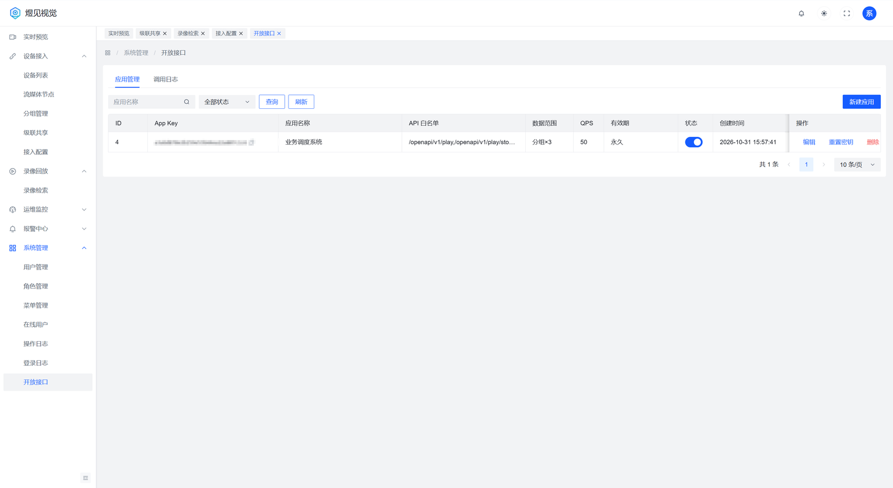
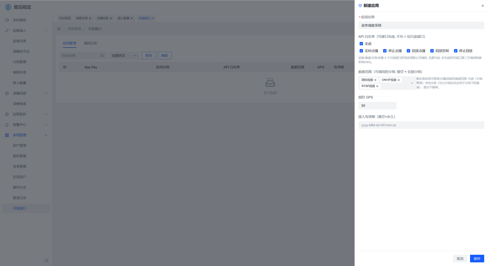

# 16 OpenAPI 对接手册（面向第三方）

> **文档导航**：[文档首页](README.md) · [快速部署](../deploy/README.md) · [部署手册](../deploy/部署手册.md) · [配置参考](配置参考.md) · [GB28181 接入](GB28181设备接入指南.md) · [ONVIF 接入](ONVIF设备接入指南.md) · [拉流代理](拉流代理接入指南.md) · [级联对接](级联对接指南.md) · [REST-API](03-REST-API设计.md) · [OpenAPI 对接](16-OpenAPI对接手册.md) · [数据库设计](02-数据库设计.md)

> 适用版本：YuJianVision v1.0.1。
> 传输：标准 HTTPS/TLS + 应用层国密签名（HMAC-SM3 默认，可按平台配置回退 HMAC-SHA256）。
> 本手册含全部所需信息：仅凭 appKey/appSecret 与本文即可完成接入（验收口径：30 分钟内跑通点播取流）。

## 1. 接入流程

1. 向平台管理员申请接入，提供应用名称、所需写接口清单、期望 QPS、接入有效期。
2. 管理员在「系统管理 → 开放接口」建卡，返回 `appKey` 与 `appSecret`（**明文仅此一次展示**，请立即妥善保存；遗失只能重置，重置后旧凭证立即失效）。
3. 按本文 §2 实现签名，调用 §4 接口。只读接口任何应用可调；写接口（点播/云台/回放）需在应用白名单内。
4. 数据范围：应用绑定了分组（channel_scope）时，通道类接口仅返回/允许该范围内的通道；未绑定 = 全部。

应用列表在「系统管理 → 开放接口 → 应用管理」：每行给出 App Key（列表可见）、应用名称、API 白名单、数据范围、
QPS、有效期、启停状态，操作列可「编辑 / 重置密钥 / 删除」；「调用日志」页签可查每次调用的结果与耗时。



「新建应用」抽屉里一次配齐：应用名称、API 白名单（勾选写接口，不勾=只读）、数据范围（可调用的分组，
留空=全部）、频控 QPS、接入有效期（留空=永久）。保存时生成 `appKey`/`appSecret`，`appSecret` 明文只展示一次。



## 2. 签名算法

### 2.1 请求头（4 个，缺一不可）

| 头 | 说明 |
|---|---|
| X-App-Key | 分配的 appKey |
| X-Timestamp | Unix 秒级时间戳；与服务器偏差须 ≤ ±300 秒 |
| X-Nonce | 随机串（建议 UUID）；**300 秒内不可重复**（防重放） |
| X-Signature | 按下述算法计算的签名（Base64） |

### 2.2 签名串与计算

```
签名串 = METHOD \n PATH \n TIMESTAMP \n NONCE \n SM3Hex(rawBody)
X-Signature = Base64( HMAC-SM3( appSecret, 签名串 ) )
```

- METHOD 大写（GET/POST）；PATH 为路径（如 `/openapi/v1/play`），**不含 query 与域名**。
- rawBody 为请求体原始字节（GET 为空串）；SM3Hex 为其 SM3 摘要的小写十六进制（64 字符）。
- 签名密钥即 appSecret 明文；算法默认 HMAC-SM3（平台配置可切换 HMAC-SHA256，结构不变）。
- 比对失败、时间戳越窗、nonce 重复、应用停用/过期，一律返回 401。
- ⚠️ **签名覆盖范围**：query string 参数不参与签名（防重放由 timestamp+nonce 承担），即 GET 参数
  不防在途篡改——**开放接口必须全程经 TLS/HTTPS 调用**，明文链路上的 GET 参数可被中间人改写。
- nonce 有效性 600 秒（2×时间窗）；nonce 由平台侧按 app 隔离去重，客户端保证 10 分钟内不重复即可。

伪代码：

```
body      = 原始请求体字节
ts        = 当前Unix秒
nonce     = 随机UUID()
signStr   = "POST" + "\n" + "/openapi/v1/play" + "\n" + str(ts) + "\n" + nonce + "\n" + hex(SM3(body))
signature = base64( HMAC_SM3(appSecret, signStr) )
```

### 2.3 接口调用示例

#### 2.3.1 Python 示例（完整可运行）

```python
import base64, json, time, uuid, urllib.request
from gmssl import sm3 as gsm3, func   # pip install gmssl

BASE   = 'https://<平台地址>'
KEY    = '<appKey>'
SECRET = '<appSecret>'

def sm3_hex(data: bytes) -> str:
    return gsm3.sm3_hash(func.bytes_to_list(data))

def hmac_sm3(key: bytes, msg: bytes) -> bytes:
    """HMAC-SM3: 结构与 HMAC-SHA256 相同(RFC 2104), 块长 64 字节"""
    block = key.ljust(64, b'\0')[:64]
    o_key = bytes(b ^ 0x5C for b in block)
    i_key = bytes(b ^ 0x36 for b in block)
    inner = bytes.fromhex(sm3_hex(i_key + msg))
    return bytes.fromhex(sm3_hex(o_key + inner))

def call(method, path, query='', body=None):
    raw      = json.dumps(body).encode() if body is not None else b''
    ts       = int(time.time())
    nonce    = uuid.uuid4().hex
    sign_str = f"{method}\n{path}\n{ts}\n{nonce}\n{sm3_hex(raw)}"
    sign     = base64.b64encode(hmac_sm3(SECRET.encode(), sign_str.encode())).decode()
    req      = urllib.request.Request(
        BASE + path + query, data=raw if method == 'POST' else None, method=method)
    for k, v in (('X-App-Key', KEY), ('X-Timestamp', str(ts)),
                 ('X-Nonce', nonce), ('X-Signature', sign)):
        req.add_header(k, v)
    if method == 'POST':
        req.add_header('Content-Type', 'application/json')
    return json.loads(urllib.request.urlopen(req).read())

print(call('GET', '/openapi/v1/devices', '?page=1&count=5'))
```

> 签名自检用国标向量：`SM3("abc") = 66c7f0f4 62eeedd9 d1f2d46b dc10e4e2 4167c487 5cf2f7a2 297da02b 8f4ba8e0`，
> 空串 `SM3("") = 1ab21d83 55cfa17f 8e611948 31e81a8f 22bec8c7 28fefb74 7ed035eb 5082aa2b`；
> 你的实现能对上这两组值，再对签名串做 HMAC-SM3 即可。

#### 2.3.2 Java 示例（完整可运行）

依赖：JDK 11+，另需 `org.bouncycastle:bcprov-jdk18on:1.78.1`（Maven 坐标，仅用 SM3 摘要与 HMAC；不要注册全局 Provider）。

```java
import org.bouncycastle.crypto.digests.SM3Digest;
import org.bouncycastle.crypto.macs.HMac;
import org.bouncycastle.crypto.params.KeyParameter;

import java.net.URI;
import java.net.http.HttpClient;
import java.net.http.HttpRequest;
import java.net.http.HttpResponse;
import java.nio.charset.StandardCharsets;
import java.time.Instant;
import java.util.Base64;
import java.util.UUID;

public class OpenApiDemo {

    static final String BASE   = "https://<平台地址>";
    static final String KEY    = "<appKey>";
    static final String SECRET = "<appSecret>";

    /** SM3 摘要小写 hex（国标 GB/T 32905-2016, BC 轻量 API） */
    static String sm3Hex(byte[] data) {
        SM3Digest d = new SM3Digest();
        d.update(data, 0, data.length);
        byte[] out = new byte[d.getDigestSize()];
        d.doFinal(out, 0);
        StringBuilder sb = new StringBuilder(out.length * 2);
        for (byte b : out) {
            sb.append(String.format("%02x", b));
        }
        return sb.toString();
    }

    /** HMAC-SM3（结构与 HMAC-SHA256 相同, RFC 2104, 块长 64B） */
    static byte[] hmacSm3(byte[] key, byte[] msg) {
        HMac mac = new HMac(new SM3Digest());
        mac.init(new KeyParameter(key));
        mac.update(msg, 0, msg.length);
        byte[] out = new byte[mac.getMacSize()];
        mac.doFinal(out, 0);
        return out;
    }

    public static void main(String[] args) throws Exception {
        String method = "GET";
        String path = "/openapi/v1/devices";
        byte[] body = new byte[0];                       // POST 时为原始 JSON 字节
        String ts = String.valueOf(Instant.now().getEpochSecond());
        String nonce = UUID.randomUUID().toString().replace("-", "");

        String signString = method + "\n" + path + "\n" + ts + "\n" + nonce + "\n"
                + sm3Hex(body);
        String sign = Base64.getEncoder().encodeToString(
                hmacSm3(SECRET.getBytes(StandardCharsets.UTF_8),
                        signString.getBytes(StandardCharsets.UTF_8)));

        HttpRequest request = HttpRequest.newBuilder(
                        URI.create(BASE + path + "?page=1&count=5"))
                .header("X-App-Key", KEY)
                .header("X-Timestamp", ts)
                .header("X-Nonce", nonce)
                .header("X-Signature", sign)
                .GET().build();
        HttpResponse<String> resp = HttpClient.newHttpClient()
                .send(request, HttpResponse.BodyHandlers.ofString());
        System.out.println(resp.statusCode() + " " + resp.body());
    }
}
```

### 2.4 curl 示例（bash，SM3 摘要以预计算值代入）

```bash
TS=$(date +%s); NONCE=$(cat /proc/sys/kernel/random/uuid)
BODY='{"channelDbId":123}'
BODY_SM3=$(python3 -c "import sys;print('需以实际SM3实现计算')" )   # = SM3Hex($BODY)
SIGN=$(python3 tools_sign_helper.py "$SECRET" "POST
/openapi/v1/play
$TS
$NONCE
$BODY_SM3")   # = Base64(HMAC-SM3(secret, 签名串))

curl -sS -X POST "$BASE/openapi/v1/play" \
  -H 'Content-Type: application/json' \
  -H "X-App-Key: $KEY" -H "X-Timestamp: $TS" \
  -H "X-Nonce: $NONCE" -H "X-Signature: $SIGN" \
  -d "$BODY"
```

## 3. 频控与有效期

- 频控按应用维度 QPS 秒级窗口，超限返回 **429**（错误码 1009）；默认 50 QPS（新建应用表单默认值,
  可按应用在管理页调整, 允许 1~1000），可按需调整。
- 有效期到期后应用自动拒绝（401），管理页可延期；停用/删除立即生效。
- 调用日志在管理页可查（结果码/失败原因/耗时/来源 IP），请避免高频无意义轮询。
- **级联通道口径**：应用数据范围内若含下级平台（级联）通道，点播/回放行为与平台 Web 端一致
  （由平台与下级的级联链路保证），不额外要求 Web 端的 `cascade:play` 用户权限。
- 「开放接口」管理页菜单对所有管理员可见；开放接口未启用（`vision.openapi.enabled=false`）时
  菜单仍显示，页面顶部会提示「开放接口功能未启用」及启用方法（不再是一堆 404 空表）——启用后自动恢复。

## 4. 接口清单（响应均为 `{code, msg, data}` 包络, code=0 成功）

| 接口 | 方法 | 说明 | 参数 |
|---|---|---|---|
| /openapi/v1/devices | GET | 设备列表 | online(0/1)、keyword、accessProtocol、page、count |
| /openapi/v1/channels | GET | 通道列表（受数据范围过滤） | deviceId、query、status、ptz、page、count |
| /openapi/v1/groups | GET | 分组树 | — |
| /openapi/v1/records | GET | 录像检索 | channelDbId、start、end（yyyy-MM-dd HH:mm:ss，跨度≤31天） |
| /openapi/v1/play | POST▲ | 实时点播 | channelDbId、tcpMode?(1=UDP/2=TCP)、streamProfile?(1主/2子) |
| /openapi/v1/play/stop | POST▲ | 停止点播 | streamId |
| /openapi/v1/ptz/control | POST▲ | 云台控制（**预留，暂未开放**；开放前请勿依赖） | channelDbId、command、speed(1~255) |
| /openapi/v1/playback/start | POST▲ | 回放点播 | channelDbId、tcpMode?、startTime、endTime |
| /openapi/v1/playback/control | POST▲ | 回放控制 | streamId、cmd(PAUSE/RESUME/SCALE/SEEK)、scale?、seekTime? |
| /openapi/v1/playback/stop | POST▲ | 停止回放 | streamId |

▲ = 写接口，需应用白名单包含该路径。点播返回 `streamId/sessionId/status/urls/videoCodec`；
会话有 Web 端同款强制回收上限（回放单会话 2h）。各接口的输入/输出逐项说明见 §5。

## 5. 接口详细说明

> 通用约定：响应包络 `{code, msg, data}`，`code=0` 成功；时间格式统一 `yyyy-MM-dd HH:mm:ss`；
> 分页参数 `page`（从 1 起）/`count`（默认 20）；列表类返回 `data.total`（总数）+ `data.list`（当前页）。
> 下述 JSON 示例省略包络、只展示 `data`；字段以实际返回为准，未列出的字段为平台内部字段（可忽略）。

### 5.1 设备列表 GET /openapi/v1/devices

| 参数 | 类型 | 必填 | 说明 |
|---|---|---|---|
| online | int | 否 | 1=在线 0=离线，缺省全部 |
| keyword | string | 否 | 模糊匹配设备国标编码/名称 |
| accessProtocol | string | 否 | 接入协议过滤（gb/onvif/rtsp） |
| page / count | int | 否 | 分页 |

`data.list` 行主要字段：`id`（库内主键）、`deviceId`（国标编码）、`name`、`manufacturer`、`model`、`firmware`、`transport`（UDP/TCP）、`online`（0/1）、`accessProtocol`、`ip`、`port`、`createTime`。
（注：设备接入密码等敏感字段不出 API。）

```json
{ "total": 2, "list": [
  { "id": 1, "deviceId": "34020000001320000001", "name": "前端-1", "online": 1,
    "transport": "UDP", "accessProtocol": "gb", "manufacturer": "Hikvision",
    "model": "IPC-T1", "ip": "10.0.0.101", "port": 5060,
    "createTime": "2026-09-26 09:00:00" } ] }
```

### 5.2 通道列表 GET /openapi/v1/channels

| 参数 | 类型 | 必填 | 说明 |
|---|---|---|---|
| deviceId | long | 否 | 按设备过滤（设备库内主键 id，非国标编码） |
| query | string | 否 | 模糊匹配通道编码/名称/自定义名称 |
| status | int | 否 | 1=在线 0=离线 |
| ptz | int | 否 | 1=仅云台通道 |
| page / count | int | 否 | 分页 |

**数据范围**：应用绑定分组时仅返回范围内通道（越权通道不会出现在结果里）。

`data.list` 行主要字段：`id`（通道库内主键，**点播/云台等接口的 channelDbId 即此值**）、`deviceDbId`、`channelId`（国标通道编码）、`name`、`customName`、`status`（0/1）、`ptzType`（0=无云台）、`manufacturer`、`model`、`longitude`、`latitude`、`directory`（true=目录节点，不可点播）。

```json
{ "total": 1, "list": [
  { "id": 123, "deviceDbId": 1, "channelId": "34020000001320000001",
    "name": "cam1", "customName": null, "status": 1, "ptzType": 0,
    "directory": false, "longitude": 104.065735, "latitude": 30.659462 } ] }
```

### 5.3 分组树 GET /openapi/v1/groups

无参数。返回 `data` 为树形数组，节点 = `{group: {...}, children: [...]}`，
`group` 主要字段：`id`（分组 id，即应用 channel_scope 里的值）、`name`、`parentId`。

```json
[ { "group": { "id": 1, "name": "全部设备", "parentId": null },
    "children": [ { "group": { "id": 2, "name": "东区", "parentId": 1 }, "children": [] } ] } ]
```

### 5.4 录像检索 GET /openapi/v1/records

| 参数 | 类型 | 必填 | 说明 |
|---|---|---|---|
| channelDbId | long | 是 | 通道库内主键（见 5.2）；须在应用数据范围内，否则 403 |
| start / end | string | 是 | `yyyy-MM-dd HH:mm:ss`；跨度 ≤31 天 |

`data.list` 行：`channelId`（国标编码）、`recordId`（设备侧重放句柄，回放用不到时忽略）、`name`、`type`、`startTime`、`endTime`（设备上报的实际录像段）。
无录像时 `total=0`；设备不支持检索或未响应时返回 1010（见 §6）。

```json
{ "total": 1, "list": [
  { "channelId": "34020000001320000001", "recordId": "0", "name": "cam1",
    "type": "time", "startTime": "2026-09-01 08:00:00", "endTime": "2026-09-01 09:30:00" } ] }
```

### 5.5 实时点播 POST /openapi/v1/play 与 /openapi/v1/play/stop

请求体（play）：

| 参数 | 类型 | 必填 | 说明 |
|---|---|---|---|
| channelDbId | long | 是 | 须在数据范围内；目录节点返回 400 |
| tcpMode | int | 否 | 1=UDP(默认) 2=TCP 被动 |
| streamProfile | int | 否 | 1=主码流(默认) 2=子码流 |

响应 `data`：

| 字段 | 说明 |
|---|---|
| streamId | 流标识，stop 时回传 |
| sessionId | 会话 id |
| status | 会话状态（ON=出流中 / INVITING=接通中等） |
| urls | 播放地址集：`flv` / `wsFlv` / `hls`，均为**带签名与过期时间的 URL**，直接可播 |
| videoCodec | H264 / H265（选播放器解码路径用） |

```json
{ "streamId": "gb_34020000001320000001_143025_a1b2",
  "sessionId": 881, "status": "ON",
  "urls": {
    "flv":   "http://<媒体节点>/rtp/gb_..._a1b2.live.flv?sign=xxxx&expire=1795800000",
    "wsFlv": "ws://<媒体节点>/rtp/gb_..._a1b2.live.flv?sign=xxxx&expire=1795800000",
    "hls":   "http://<媒体节点>/rtp/gb_..._a1b2/hls.m3u8?sign=xxxx&expire=1795800000" },
  "videoCodec": "H264" }
```

stop 请求体：`{ "streamId": "gb_..._a1b2" }`，成功 `code=0`。
注意事项：`status=INVITING` 时设备尚未出流，请轮询或延时后再拉流；URL 签名有 `expire`，过期需重新点播；
同一通道重复点播会复用已有会话（Web 端同口径）。

**播放地址有效期（expire）行为**：URL 带 `sign` + `expire`（**签发后 1 小时**）, 是 ZLM 的"取流准入凭证"：

- **HTTP-FLV / WS-FLV 长连接**：连接建立后 ZLM 不再校验 expire——只要连接不断、流在播，超过 1 小时也**继续有效**；
- **HLS**：播放器每隔数秒重新拉取 m3u8 索引, 每次都会校验 expire——**超过 1 小时后续播会失败**, 需重新点播获取新地址；
- **断线重连 / 刷新 / 换播放器**：连接重建时 expire 已过即被拒, 需重新调 `/openapi/v1/play` 取新地址
  （会话仍在存活期内时重复点播会复用会话, 秒级返回新 URL）；
- URL 有效期与会话生命周期是两回事：有播放器在消费流, 会话就不会被空闲回收; 会话因停播/回收结束后,
  任何 URL 都不再可用。对接建议：把 URL 当"一次性取流凭证"使用, 失效即重新点播, 不要长期缓存复用。

### 5.6 回放点播 POST /openapi/v1/playback/start

请求体：

| 参数 | 类型 | 必填 | 说明 |
|---|---|---|---|
| channelDbId | long | 是 | 须在数据范围内 |
| tcpMode | int | 否 | 缺省 TCP 被动（与 Web 端一致） |
| startTime / endTime | string | 是 | 回放窗口，跨度 ≤31 天 |

响应 `data` 在 5.5 基础上多一个 `controlMode`：`sip`=GB 全控 / `seek`=仅拖动 / 空=按 GB 处理。
单会话有 2 小时强制回收上限。

```json
{ "streamId": "gb_playback_34020000001320000001_143025_c3d4",
  "sessionId": 882, "status": "ON",
  "urls": { "flv": "http://<媒体节点>/rtp/.../hls.m3u8?sign=...&expire=..." },
  "videoCodec": "H264", "controlMode": "sip" }
```

### 5.7 回放控制 POST /openapi/v1/playback/control

请求体：

| 参数 | 类型 | 必填 | 说明 |
|---|---|---|---|
| streamId | string | 是 | 5.6 start 返回的流标识 |
| cmd | string | 是 | PAUSE / RESUME / SCALE / SEEK |
| scale | decimal | cmd=SCALE 时 | 倍速（如 0.5/1/2/4） |
| seekTime | string | cmd=SEEK 时 | 目标时间 `yyyy-MM-dd HH:mm:ss` |

成功 `code=0` 无 data；会话不存在或已结束返回 1007。

### 5.8 停止回放 POST /openapi/v1/playback/stop

请求体：`{ "streamId": "5.6 返回的流标识" }`，成功 `code=0`。

### 5.9 云台控制（预留，暂未开放）

`POST /openapi/v1/ptz/control` 暂不开放（平台侧路由已摘除，调用返回 404）。开放后会在此处补齐说明，
请勿在对接代码中依赖该接口。

## 6. 错误码

## 6. 错误码

**401 的子原因对照**（HTTP 401, 包络 code 恒为 401, 具体原因看 `msg`，调用日志"失败原因"列同文案）：

| msg | 原因与处置 |
|---|---|
| 缺少签名请求头 | 4 个 X- 头未带全 |
| 时间戳格式非法 | X-Timestamp 不是整数（应为 Unix **秒**，非毫秒） |
| **时间戳超出允许窗口** | 客户端时钟与服务器偏差 >±5 分钟——**校时/启用 NTP**，这是联调期最常见问题 |
| nonce 重放 | 同一 nonce 10 分钟内重复使用，改为每次请求生成新随机串 |
| 应用凭证无效 / 应用无效/停用/过期 | appKey 错误、应用被停用/删除、超出接入有效期——联系管理员 |
| 签名不符 | 签名串拼接/摘要/密钥任一不对，按 §2.2 逐项对拍 |

其余错误码：

| HTTP | 包络 code | 含义 |
|---|---|---|
| 200 | 0 | 成功 |
| 200 | 400 | 参数错误（含时间格式非法） |
| 401 | 401 | 签名/时间窗/nonce 重放/应用无效·停用·过期 |
| 403 | 403 | 接口不在白名单 / 通道不在数据范围 |
| 404 | 404 | 资源不存在 |
| 429 | 1009 | 触发频控 |
| 500/503 | 500 | 平台内部错误 / Redis 不可用 fail-closed（安全优先拒绝） |

业务错误码：1001 设备离线 / 1003 INVITE 失败 / 1006 流未就绪 / 1007 会话不存在 / 1008 无录像 /
1010 录像查询超时 / 1012 对讲不可用等，与平台内接口一致（见 03-REST-API设计 §1.4）。
