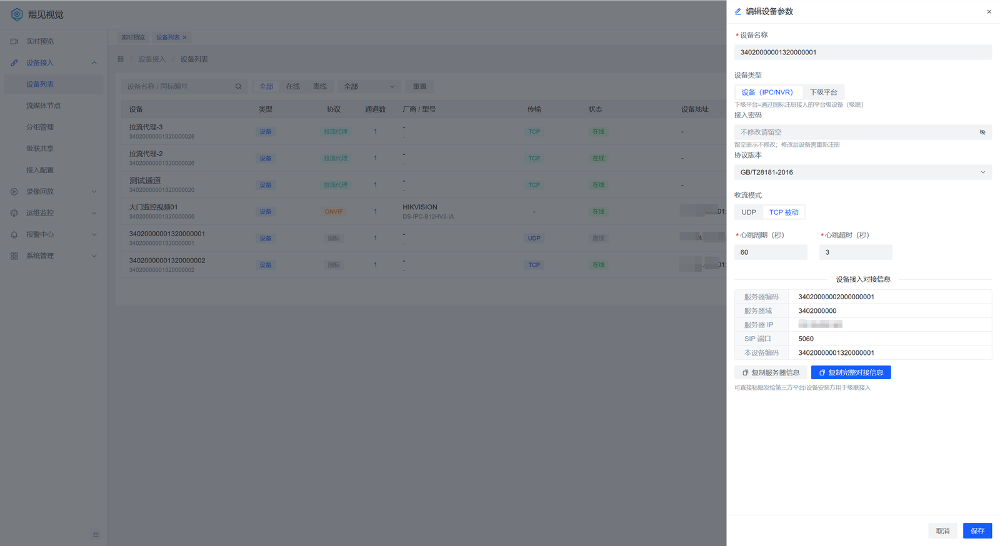
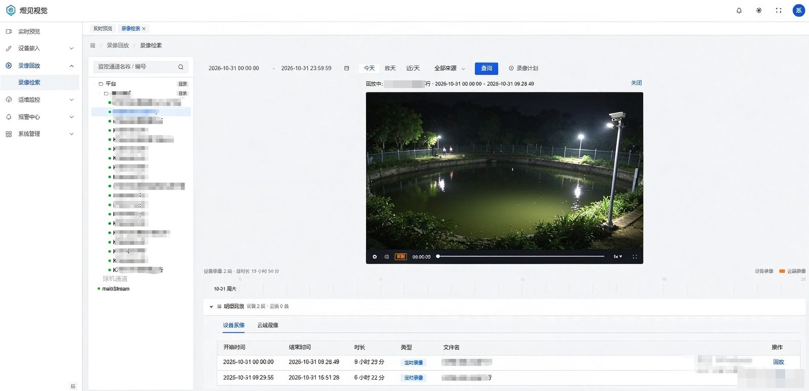

# GB28181 设备接入指南

> **文档导航**：[文档首页](README.md) · [快速部署](../deploy/README.md) · [部署手册](../deploy/部署手册.md) · [配置参考](配置参考.md) · [GB28181 接入](GB28181设备接入指南.md) · [ONVIF 接入](ONVIF设备接入指南.md) · [拉流代理](拉流代理接入指南.md) · [级联对接](级联对接指南.md) · [REST-API](03-REST-API设计.md) · [OpenAPI 对接](16-OpenAPI对接手册.md) · [数据库设计](02-数据库设计.md)

本指南面向要把国标（GB/T 28181-2016/2022）摄像机、NVR 或下级平台接入本平台的使用者，
覆盖平台侧准备、设备侧配置、接入验证与常见故障排查。

---

## 1. 接入前确认

| 项 | 要求 |
|---|---|
| 网络 | 设备能访问平台 **5060/udp**（或 5060/tcp，二选一按设备支持）；平台能访问设备的媒体收流端口 |
| 设备 | 支持 GB/T 28181-2016 或 2022；已获得 20 位设备编码与通道编码 |
| 平台 | 已完成部署且 `/actuator/health` 为 UP；「设备接入 → 流媒体节点」中至少一个节点在线 |
| 时间 | 平台与设备时间同步（建议 NTP），偏差过大会导致注册鉴权与目录校验异常 |

设备编码规则（20 位）：中心编码 8 位 + 行业编码 2 位 + 类型编码 3 位 + 网络标识 1 位 + 序号 6 位。
平台自身编码在「设备接入 → 接入配置」中查看，**不要与设备编码重复**。

## 2. 平台侧准备

### 2.1 查看接入参数

进入「设备接入 → 接入配置」，第一张卡片「设备侧对接信息」给出设备侧要填写的内容（只读，值来自 `vision.gb.*` 配置）：

| 参数 | 说明 |
|---|---|
| 服务器国标编码 | 平台自身国标编码（20 位） |
| 国标域 | 平台域名编码（通常为 10 位中心编码） |
| SIP 端口 | 5060（UDP/TCP 双栈同时监听） |
| 服务器 IP | 平台对外 IP（未显式配置时取当前访问地址） |
| 信令传输 | 平台支持的传输方式（UDP / TCP） |

右上角「复制对接信息」可把上面几项整段复制，直接发给设备安装方。

> 注意：这一页**不展示密码明文**。对接信息复制给设备厂商时，密码由你自己补充告知。

### 2.2 决定接入模式

「接入配置」第二张卡片「接入模式」是一个开关，两种形态：

- **白名单（关闭，推荐）**：先在平台预建档（§2.3）录入 20 位设备编码与密码，设备只能用这个编码+密码注册；
  未建档的设备即使密码正确也会被拒绝。适合设备数量可控、要求可控接入的场景。
- **开放（开启自动注册）**：任何知道「默认接入密码」的设备都可注册并自动建档（第三张卡片改密码）。
  适合快速试点，**生产环境不建议长期开启**。

### 2.3 预建档一台设备

「设备接入 → 设备列表 → 添加国标设备」填写：

| 字段 | 说明 |
|---|---|
| 国标编码 | 20 位国标编码，注册时的 SIP 用户名 |
| 设备名称 | 展示名，可后续由设备目录上报名称覆盖 |
| 接入密码 | 与设备侧 SIP 密码一致 |
| 设备类型 | 设备（IPC/NVR）/ 下级平台 |
| 协议版本 | GB/T28181-2016（默认）/ 2022 |
| 收流模式 | TCP 被动（推荐）/ UDP |

保存后设备处于「离线」是正常的——它还没有注册。

建档后打开该设备的「编辑」抽屉，底部「设备接入对接信息」会给出这台的服务器编码、域、SIP 端口与本设备编码，
「复制完整对接信息」可一次复制给设备安装方：

## 3. 设备侧配置

以常见摄像机/NVR 的 SIP 配置页为例（不同厂商字段名略有差异）：

| 设备侧字段 | 取值 |
|---|---|
| SIP 服务器 ID | 平台的 SIP 服务器编码（20 位） |
| SIP 服务器域 | 平台域名编码 |
| SIP 服务器地址 | 平台 IP |
| SIP 服务器端口 | 5060 |
| 传输协议 | UDP 或 TCP（与平台能力一致；TCP 更抗丢包，跨 NAT 更稳） |
| SIP 用户名 | 20 位设备编码 |
| SIP 认证密码 | 平台预建档时填的密码 |
| 注册有效期 | 3600 秒（平台按到期前刷新，无需特殊设置） |
| 心跳周期 | 60 秒（平台默认按 60 秒 × 3 次无心跳判离线） |
| 通道编码 | 20 位通道编码，平台按目录上报自动建通道 |

保存并启用 GB28181 后，设备应显示「注册成功」。

> **TCP 接入的一个坑**：部分设备 TCP 注册时把 Contact 端口填成临时源端口，平台已在
> 服务端把 TCP 设备的外呼端口固定为 5060，无需在设备上改端口。

## 4. 验证接入

按顺序检查，前一步不通过不要看后一步：

1. **设备在线**：「设备接入 → 设备列表」中该设备状态变为在线（最后一次心跳时间持续刷新）。
2. **目录同步**：设备在线后平台自动查询一次目录；如需重查，点设备行「刷新目录」，
   同步期间可看进度条，结束后点该行「通道」弹出的通道抽屉里出现该设备的通道。
3. **实时预览**：进入「实时预览」，选择该通道，画面出图即链路通。
   首次出图通常 1~3 秒；60 秒仍无画面按 §5 排查。
4. **码流选择**：预览窗口可选主/子码流（`streamProfile` 1=主 2=子），多宫格建议子码流。
5. **云台**：球机在预览窗口出现方向/变倍控件（依据设备目录上报的 `ptz_type` 能力位）；
   操作后设备实际转动。
6. **预置位**：云台面板「预置位」可设置/调用/删除，编号由设备决定。
7. **语音对讲**：设备支持 GB28181 对讲时，预览窗口对讲按钮可下发音频（2016 广播能力视设备而定）。
8. **录像检索与回放**：设备侧有存储（SD 卡/NVR）时，「录像回放 → 录像检索」可按时间段检索并回放，
   支持暂停/继续、倍速、拖动（拖动由平台重建取流实现）。

   
9. **云端录像与抓图**：实时预览时平台可按计划/手动触发云端录制与抓图，产物在「云端录像」中查看。

## 5. 常见问题

| 现象 | 可能原因 | 处理 |
|---|---|---|
| 设备一直离线，注册失败 | 密码与平台预建档不一致；设备编码错误；域编码不匹配 | 核对 20 位编码与密码；确认平台的域/Realm 已填入设备 |
| 设备显示「注册成功」但很快又离线 | 心跳未生效或网络中断；平台判离线窗口 60×3=180 秒 | 检查设备心跳开关；抓包确认 5060 双向可达 |
| 注册成功但通道列表为空 | 设备不支持目录查询，或目录消息未到达平台 | 点「刷新目录」重试；确认设备目录能力开启；跨网段时检查 UDP 5060 丢包 |
| 点「预览」无任何反应 | 平台无法向设备发起 INVITE（NAT/防火墙/Contact 端口） | 确认平台能访问设备；TCP 注册设备检查 SIP 端口；必要时改用 TCP 传输 |
| 已应答但一直不出图 | UDP 收流丢包；设备推流地址不可达 | 设备侧改 TCP 收流；平台默认开启 UDP 超时自动降级 TCP 重邀 |
| 画面黑屏但流已建立 | H.265 且浏览器无硬解；音频编码不被支持 | 平台自动切 WASM 软解；音频建议 AAC 或直接关闭（G.711 不被浏览器支持） |
| 云台控件不显示 | 设备目录未上报云台能力（`ptz_type=0`） | 换球机验证；或在通道编辑中按设备实际能力配置 |
| 回放检索超时报 1010 | 设备无录像能力，平台等待 15 秒收敛 | 确认设备确有存储；同一通道 60 秒内会有失败快速通道 |
| 对讲无声音 | 设备不支持 2016 广播；音频编码不匹配 | 用预览确认设备音频编码；对讲走平台直推，设备需支持

## 6. 参数速查

| 参数 | 默认 | 位置 |
|---|---|---|
| SIP 端口 | 5060（UDP+TCP 双栈） | 平台配置 |
| 设备心跳周期 | 60 秒 | 设备侧 / 平台设备编辑可改 |
| 心跳超时次数 | 3 次 | 平台设备编辑 |
| 判离线窗口 | 心跳周期 × 超时次数 = 180 秒 | 由上面两项计算 |
| 默认协议版本 | 2016 | 预建档 / 设备编辑 |
| 收流方式 | 按设备档案 `media_tcp_mode` | 预建档 / 设备编辑 |
| 点播建流超时 | 60 秒（已应答未到流兜底关停） | 平台配置 |
| 录像检索等待 | 15 秒（无录像能力收敛） | 平台固定 |
