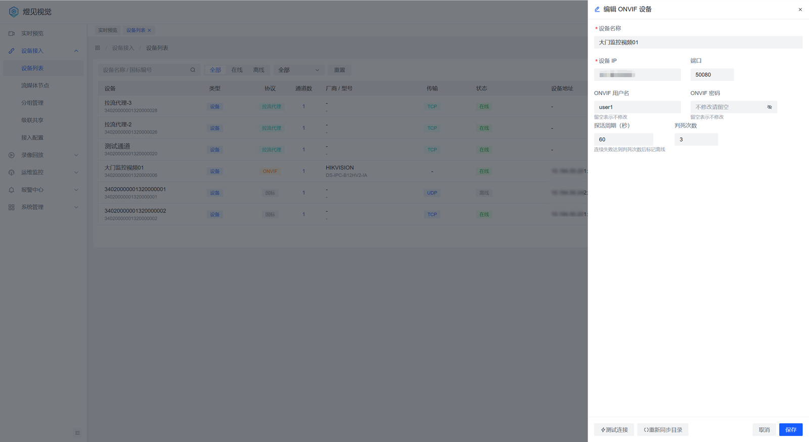
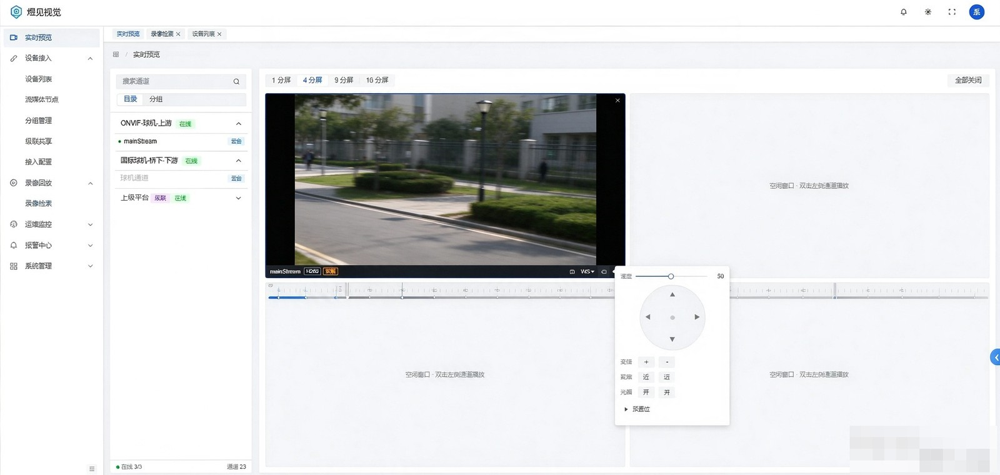

# ONVIF 设备接入指南

> **文档导航**：[文档首页](README.md) · [快速部署](../deploy/README.md) · [部署手册](../deploy/部署手册.md) · [配置参考](配置参考.md) · [GB28181 接入](GB28181设备接入指南.md) · [ONVIF 接入](ONVIF设备接入指南.md) · [拉流代理](拉流代理接入指南.md) · [级联对接](级联对接指南.md) · [REST-API](03-REST-API设计.md) · [OpenAPI 对接](16-OpenAPI对接手册.md) · [数据库设计](02-数据库设计.md)

ONVIF 接入适用于不便改造成国标、但支持 ONVIF Profile S/T 的网络摄像机与 NVR。
平台通过 ONVIF 完成设备发现、认证、能力查询与云台控制，媒体流按设备返回的 RTSP 地址拉取。

---

## 1. 接入前确认

| 项 | 要求 |
|---|---|
| 设备 | 支持 ONVIF（Profile S 出流；Profile T/G 视设备能力提供 PTZ、事件） |
| 账号 | 已在设备上**开启 ONVIF 并创建专用账号**（多数设备需要单独授权 ONVIF 用户，普通 Web 账号不一定有权限） |
| 网络 | 平台能访问设备的 ONVIF 端口（常见 80 / 8000 / 2020，以设备为准）与 RTSP 端口（常见 554） |
| 平台 | 已完成部署；`/actuator/health` 为 UP |

> 与国标不同，ONVIF 设备**不需要**在平台侧提前建通道：添加设备时平台会读取设备的媒体 Profile，
> 并据此自动建通道（每个 Profile 对应一路码流）。

## 2. 添加方式一：IP + 账号密码（推荐）

「设备接入 → 设备列表 → 添加ONVIF设备」：

1. 填写设备 IP、ONVIF 端口（默认 80）、用户名、密码，点**测试连接**。
   测试会返回设备厂商/型号/固件与可用的媒体通道预览，用于确认网络与账号可用。
2. 确认通道无误后保存。平台建档后立即执行一次目录同步，失败会整体回滚，不留半成品。
3. 列表出现该设备与对应通道，状态为在线。

编辑设备时可修改名称、IP、端口、账号密码、探活周期与判死次数；**密码留空表示不修改**。



## 3. 添加方式二：同网段探测（WS-Discovery）

「设备接入 → 设备列表 → 添加ONVIF设备」，展开抽屉顶部的「同网段探测（自动发现局域网 ONVIF 设备）」折叠区，
点「开始探测」会向同网段组播发送 WS-Discovery 探测，列出响应的 ONVIF 设备，点「填入」可回填地址。

- 探测**只负责发现**，结果仍需用 IP + 账号密码手动建档（ONVIF 探测不返回可用凭据）。
- 探测仅在有 SIP 主身份的实例上执行（多实例部署时避免重复探测）。
- **多网卡服务器必须显式指定探测网卡**，否则结果恒为空：

```properties
# vision.env（或 application.yaml）
VISION_ONVIF_DISCOVERY_INTERFACEIP=192.168.1.10   # 与目标设备同网段的平台侧地址
```

- 组播不通（跨三层、交换机禁组播、容器网络）时探测不会有结果，改用方式一。

## 4. 验证接入

1. **设备与通道在线**：设备列表状态在线，点该行「通道」，通道抽屉中每个媒体 Profile 一行通道。
2. **实时预览**：选择通道出图；同一通道多观众复用一路拉流，不会重复拉流。
3. **云台**：球机/云台相机在预览窗口操作方向、变倍、聚焦、光圈；操作后设备实际动作。

   
4. **预置位**：云台面板可列出设备已有预置位（平台通过 ONVIF 查询），支持设置/调用/删除。
5. **回放**：设备侧有存储且支持 ONVIF Replay 时，可按时间段检索并回放，支持拖动
   （平台按拖动目标重新发起取流，不做流内跳转）。
6. **接入标记**：探测列表中已接入设备的地址会被标记，避免重复建档。

## 5. 常见问题

| 现象 | 可能原因 | 处理 |
|---|---|---|
| 测试连接报认证失败 | ONVIF 用户未开启或权限不足；密码含特殊字符未转义 | 在设备 Web 页「ONVIF/集成」中新建专用账号并勾选媒体权限 |
| 测试连接超时 | 端口不对；设备只开放特定 ONVIF 端口 | 逐一尝试 80 / 8000 / 2020；确认无防火墙拦截 |
| 探测结果恒为空 | 多网卡未配 `interface-ip`；跨网段组播不通；设备未开 WS-Discovery | 配 `VISION_ONVIF_DISCOVERY_INTERFACEIP`；改用 IP 手填方式 |
| 添加成功但通道列表为空 | 设备未返回媒体 Profile（部分设备需先启用视频编码） | 在设备上确认主/子码流已启用后重新同步 |
| 预览黑屏 / 长时间不出图 | 平台到设备 554 不通；RTSP 账号密码与 ONVIF 账号不同 | 用 VLC 以 ONVIF 返回的 RTSP 地址验证；按设备要求给 RTSP 单独授权 |
| 云台不动，接口却返回成功 | 部分设备的 PTZ 需要先置速度再下发持续移动 | 在预览面板松开摇杆应自动发停止指令；若仍不动，用设备自带客户端交叉验证 |
| 聚焦/光圈无效果 | 设备不支持 Imaging 服务 | 该类能力按设备能力位隐藏，属设备限制 |
| 回放只能从整段开头播 | 设备录像按整窗单段返回 | 平台会对拖动做重建代理；起点仍在整段内，属设备检索粒度限制 |
| 设备频繁掉线 | 探活周期过短或设备响应慢 | 编辑设备放宽探活周期；确认 ONVIF 查询未被设备限流 |

## 6. 参数速查

| 参数 | 默认 | 位置 |
|---|---|---|
| ONVIF 端口 | 80 | 添加设备时填写 |
| 探测网卡 | 自动 | `vision.onvif.discovery.interface-ip` |
| 探活周期 | 按设备行配置 | 设备编辑 |
| 播放地址 | 平台按节点拼接，可用 `vision.play.public-base` 覆盖 | 平台配置 |
