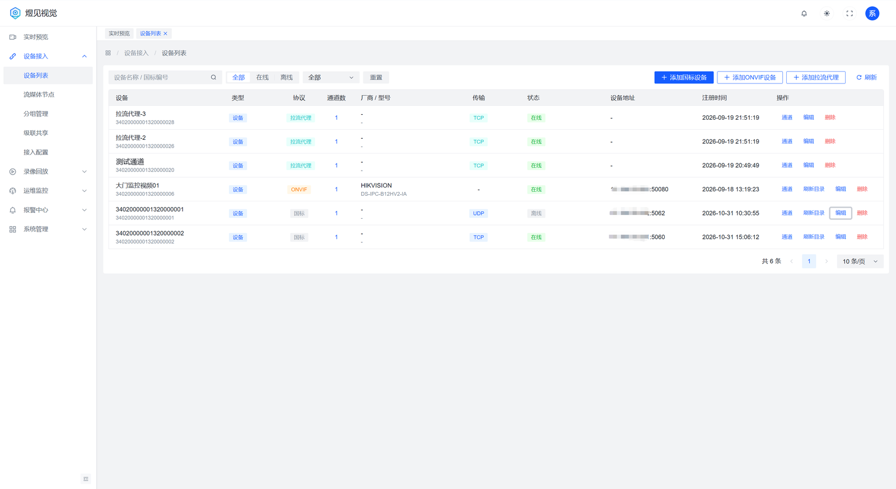
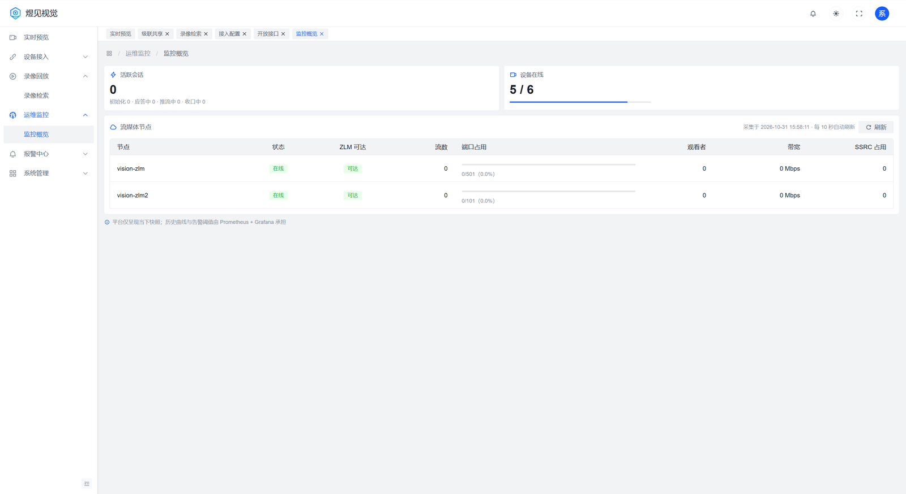
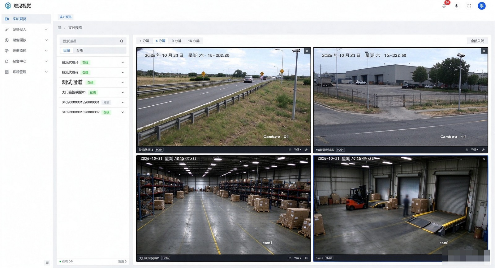
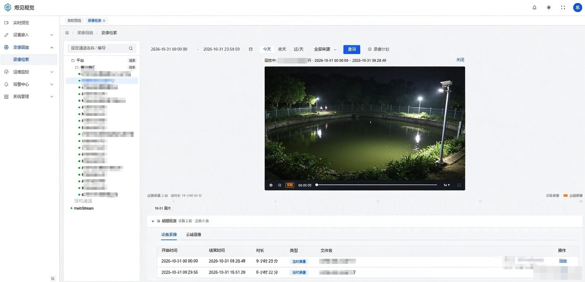

# 煜见视频平台 · 文档导航

面向 GB/T 28181（国标）、ONVIF 与 RTSP 设备的一体化视频接入与流转发平台。
本目录收录**对外使用与对接文档**；研发设计、迭代计划与验收记录等内部文档不在公开发布范围内。

---

## 一、按目标找文档

| 我想…… | 看这篇 | 说明 |
|---|---|---|
| 把平台装起来 | [快速部署](../deploy/README.md) | 容器化一条命令起栈；裸机 systemd 六步 |
| 装好之后怎么运维 | [部署手册](../deploy/部署手册.md) | 升级回滚、主备高可用、常见故障 |
| 查参数/端口/容量 | [配置参考](配置参考.md) | 环境变量逐项、端口、容量、监控、数据保留 |
| 用 Docker 一键部署 | [容器化部署说明](../deploy/compose/README.md) | compose 形态，含 ZLM/MySQL/Redis/前端 |
| 接入国标摄像头/下级平台 | [GB28181 设备接入指南](GB28181设备接入指南.md) | SIP 注册、目录同步、点播、云台、对讲、常见失败 |
| 接入 ONVIF 摄像头 | [ONVIF 设备接入指南](ONVIF设备接入指南.md) | 账号探测、设备发现、通道导入、PTZ |
| 接入 RTSP 流（NVR/编码器/网络摄像头） | [拉流代理接入指南](拉流代理接入指南.md) | 批量导入、协议筛选、探活与常驻收敛 |
| 与上级/下级平台级联 | [级联对接指南](级联对接指南.md) | 上下级注册、目录、点播转推、回放与云台透传 |
| 对接平台 HTTP 接口 | [REST-API 接口参考](03-REST-API设计.md) | 全部管理面接口、响应包络、错误码、WS 事件 |
| 让第三方系统调平台能力 | [OpenAPI 对接手册](16-OpenAPI对接手册.md) | 签名算法、鉴权、8 个开放接口、示例代码 |
| 理解数据库表结构 | [数据库设计](02-数据库设计.md) | 表、字段、索引、软删与加密字段约定 |

## 二、平台界面速览

登录后左侧为功能导航，主区为多页签工作区（每个页签各自保留状态）。

**设备列表**：国标、ONVIF、拉流代理共用一张列表，右上角三个按钮分别建档；通道数、状态与每行的「通道」入口在这里。

**监控概览**：活跃会话、设备在线数与流媒体节点负载（流数、端口占用、观众数、带宽）实时刷新。

**实时预览**：1/4/9/16 分屏，左侧按目录或分组选通道，双击出图；窗口内可切主/子码流与播放协议。

**录像检索与回放**：按时间段检索设备录像与云端录像，时间轴上可拖动、倍速、暂停。

## 三、平台能力速览

- **设备接入**：GB28181（UDP/TCP 双栈 SIP）、ONVIF（含 WS-Discovery 探测）、RTSP 拉流代理；三者可混合接入同一套通道模型。
- **实时预览**：HTTP-FLV / WS-FLV / HTTP-TS / HLS / WebRTC 五种播放地址；同一通道多观众复用一路流；UDP 收流超时自动降级 TCP。
- **H.265**：浏览器无 HEVC 硬解时自动切 WASM 软解兜底（长播有自愈看门狗）。
- **录像与回放**：设备录像检索/回放（含暂停、变速、拖动），云端录像录制与保留策略，服务端抓图。
- **控制能力**：云台方向/变倍/聚焦/光圈、预置位、语音对讲（GB28181 2016 广播与平台直推）。
- **级联**：作为下级向上级注册、作为上级接收下级注册；目录、点播转推（UDP/TCP）、回放控制、云台透传。
- **权限**：项目隔离、内置角色（项目管理员/成员）+ 自定义角色、按分组的数据范围授权。
- **开放接口**：appKey/appSecret + HMAC-SM3（可配置回退 HMAC-SHA256）签名，含频控、nonce 防重放、白名单与调用日志。

## 四、部署形态与端口

| 形态 | 说明 |
|---|---|
| 裸机（systemd） | 平台 jar + systemd 单元，MySQL/Redis/ZLM 可按现场既有实例接入 |
| 容器化（docker compose） | MySQL/Redis/ZLM/平台/前端五容器，`setup.sh` 一键生成密钥并起栈 |

| 端口 | 用途 |
|---|---|
| 5060/udp、5060/tcp | SIP（国标设备与级联注册） |
| 8082/tcp | 平台 API（含 `/api/hooks/*` 媒体回调、`/actuator/health`） |
| 8090/tcp | 前端入口（compose 形态；裸机按你的 Nginx 配置） |
| 8081/tcp | ZLM HTTP（hook 源、播放地址） |
| 554/tcp、1935/tcp | ZLM RTSP / RTMP |
| 30000-30500/udp+tcp | ZLM RTP 收流端口段（上/下级级联推流亦走此段） |

## 五、约定

- 文档中的 IP、域名、口令均为示例占位值；**上线前必须按 [SECURITY.md](../SECURITY.md) 逐项替换**。
- 接口鉴权：管理面用登录 Token（`Authorization: Bearer`），开放接口用签名头（见 OpenAPI 手册）。
- 响应包络统一为 `{"code":0,"msg":"success","data":...}`，`code != 0` 为业务错误，错误码见 REST-API 参考 §1.4。

## 六、反馈

- 缺陷请提交 Issue，并附版本号（`/actuator/health` 或发行包 MANIFEST）、部署形态、复现步骤与相关日志。
- 安全漏洞请按 [SECURITY.md](../SECURITY.md) 私下报告，勿公开提交。
