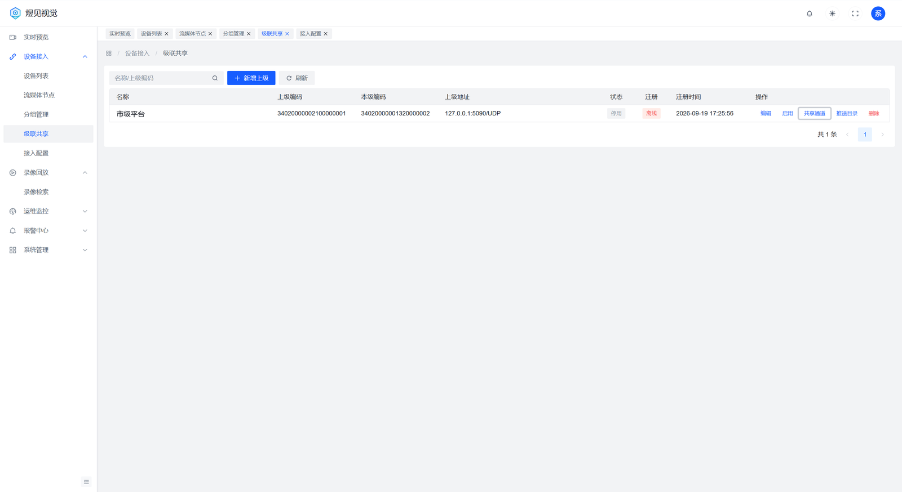
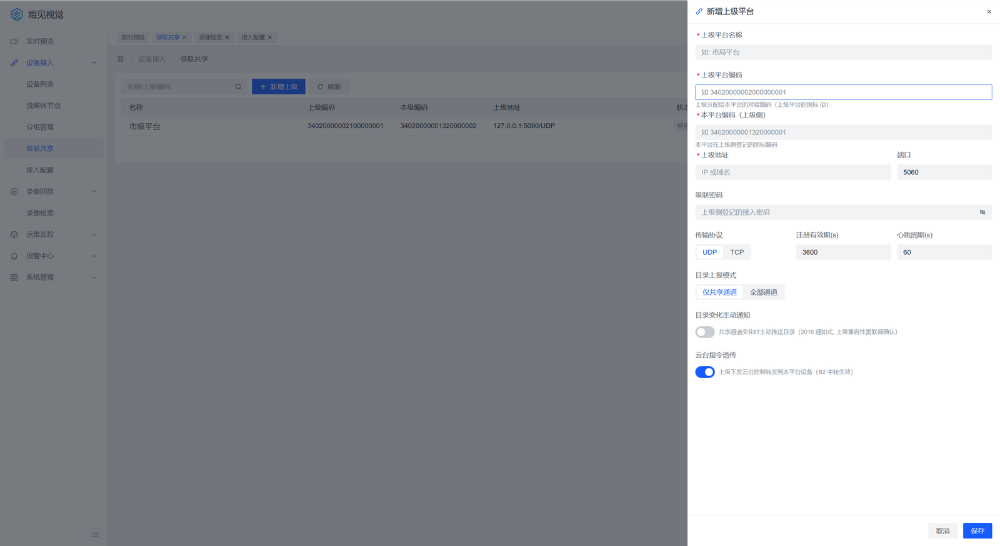
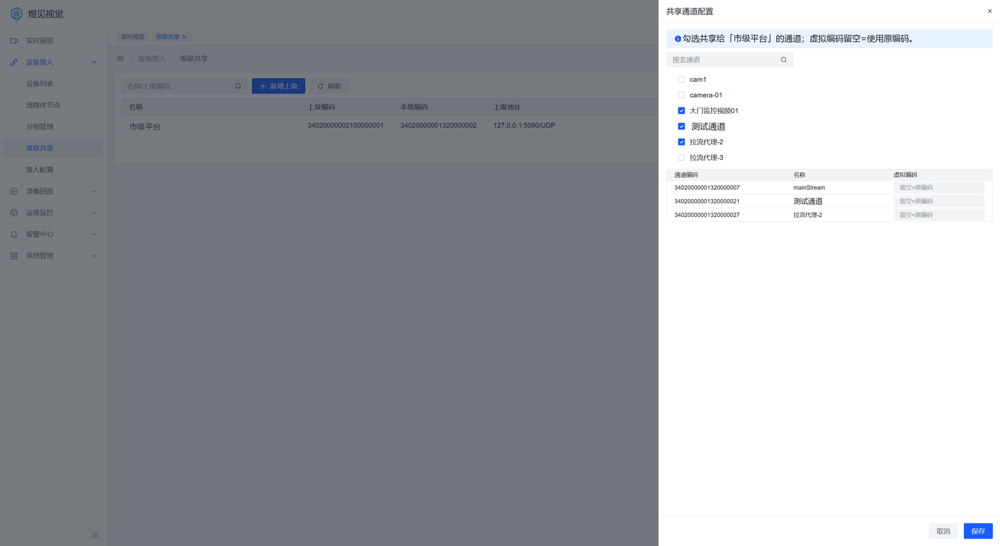

# 级联对接指南

> **文档导航**：[文档首页](README.md) · [快速部署](../deploy/README.md) · [部署手册](../deploy/部署手册.md) · [配置参考](配置参考.md) · [GB28181 接入](GB28181设备接入指南.md) · [ONVIF 接入](ONVIF设备接入指南.md) · [拉流代理](拉流代理接入指南.md) · [级联对接](级联对接指南.md) · [REST-API](03-REST-API设计.md) · [OpenAPI 对接](16-OpenAPI对接手册.md) · [数据库设计](02-数据库设计.md)

级联（GB/T 28181 平台互联）让本平台既能作为**下级**向上级平台注册并共享通道，
也能作为**上级**接收下级平台/设备的注册。两种角色可同时启用，互不影响。

---

## 1. 角色与能力对照

| 角色 | 配置入口 | 平台承担的工作 |
|---|---|---|
| 作为下级（向上级注册） | 「设备接入 → 级联共享」 | 主动 REGISTER、上报目录、接受上级 INVITE 并转推实时流、回放控制、云台透传 |
| 作为上级（接收下级） | 「设备接入 → 设备列表 → 添加国标设备（设备类型=下级平台）」 | 接受下级 REGISTER、查询目录、向下级发起点播/回放/云台 |

两种角色的共同前提：平台自身 20 位编码与域编码已在「设备接入 → 接入配置」中正确设置，
且 5060 端口对级联对端可达。

## 2. 作为下级：向上级平台注册

### 2.1 上级侧需要先做

1. 在上级平台登记本平台：本平台的 SIP 编码、域、IP、端口（5060）、认证密码。
2. 上级平台会给本平台分配**对接编码**（本平台在上级侧登记的国标编码，填到「本平台编码（上级侧）」），
   并为本平台通道预留编码段（共享通道需要用这些编码上报）。
3. 确认上级平台能访问本平台 5060，本平台能访问上级平台 5060。

### 2.2 在平台侧配置上级

「设备接入 → 级联共享 → 新增上级」：

| 字段 | 说明 | 易错点 |
|---|---|---|
| 上级平台名称 | 自定义，仅展示 | — |
| 上级平台编码 | 上级平台的 20 位 SIP 编码 | 必须与上级登记的编码完全一致 |
| 本平台编码（上级侧） | 本平台在上级侧登记的国标编码 | 按上级分配值填；注册登录名由平台按对端本域编码自动推导 |
| 上级地址 / 端口 | 上级平台 IP 与 SIP 端口 | 跨网段注意 NAT |
| 级联密码 | 上级登记时设置的密码 | 长度/字符与上级登记一致；编辑时留空=不修改 |
| 传输协议 | UDP / TCP | 与上级监听方式一致；跨 NAT 建议 TCP |
| 注册有效期(s) | 默认 3600 | 平台在到期前自动刷新 |
| 心跳周期(s) | 默认 60 | 与上级判离线阈值匹配 |
| 目录上报模式 | 仅共享通道 / 全部通道 | 选「仅共享通道」时**必须先绑定共享通道**，否则上级看不到任何通道 |
| 目录变化主动通知 | 开=通道变化时主动推送 | 关闭时只能手动「推送目录」 |
| 云台指令透传 | 开=上级云台指令转给本平台设备 | 关闭后上级只能看不能控 |

保存后配置默认是**停用**状态，需点「启用」才会开始注册。

### 2.3 绑定共享通道

在「级联共享」列表点该上级的「共享通道」，抽屉中逐个勾选要给上级看的通道，可为每个通道填写
**虚拟编码**（上级分配的 20 位通道编码，留空=沿用原编码）。绑定是**整体替换**语义：每次保存提交完整列表。

> 目录上报模式选「全部通道」时，平台会为所有通道分配编码上报；选「仅共享通道」时只报已绑定通道。

### 2.4 验证（作为下级）

1. 「级联共享」列表该条状态变为**已注册**（平台日志出现成功注册记录）。
2. 目录：上级平台能列出本平台共享的通道；改了共享通道后点「推送目录」（或依赖自动推送）。
3. 上级点播：上级对本平台通道点播，本平台会把上级 INVITE 转为对设备的 INVITE 并转推流。
   跨 NAT/丢包场景建议双方都配 TCP：平台的级联转推支持 TCP 送流。
4. 回放：上级对通道发起历史回放，平台转查设备录像；暂停/倍速/拖动由平台转成设备的回放控制指令
   （部分设备不支持 MANSRTSP 的 INFO，平台以**重建取流**方式实现拖动）。
5. 云台：上级下发云台指令，平台透传给设备（需要开启云台转发且有该通道权限）。
6. 预置位：上级查询预置位时，平台向设备实时查询后回送，不做本地缓存。

## 3. 作为上级：接收下级注册

1. 「设备接入 → 设备列表 → 添加国标设备」，设备类型选 **下级平台**，填写下级平台的 20 位编码与接入密码。
2. 下级平台按其自身配置向本平台 5060 注册；注册成功后本平台按目录查询下级通道。
3. 点该行「通道」，通道抽屉中出现下级上报的通道，可预览、点播、回放、云台（能力取决于下级上报）。
4. 若开启「允许自动注册」，未预建档的下级平台可用默认密码直接注册（生产不建议）。

## 4. 常见问题

| 现象 | 可能原因 | 处理 |
|---|---|---|
| 上级侧一直注册失败（401） | 「本平台编码（上级侧）」填错；级联密码与上级登记不一致 | 按上级分配值改编码；核对称谓与密码，保存后点「启用」 |
| 注册成功但上级看不到通道 | 目录上报模式选「仅共享通道」却未绑定；目录变化主动通知关闭 | 绑定共享通道后点「推送目录」 |
| 上级点播黑屏 | 平台 SDP 中媒体地址不可达（NAT/多网卡）；转推端口未放通 | 核对平台宣告 IP 与 30000-30500 端口段对上级可达 |
| 上级点播出图慢 | UDP 丢包导致重试，或跨网段 | 双方改 TCP；平台支持级联 TCP 转推 |
| 回放控制返回 400 | 设备不支持 MANSRTSP 的 INFO 方法 | 平台对拖动采用重建取流；暂停/倍速是否可用取决于设备 |
| 拖动后从整段重新开始 | 设备回放按整窗单段 | 属设备检索粒度限制，非平台缺陷 |
| 上级云台无效 | 未开启「云台转发」；通道权限不足 | 开启云台转发并为该用户/角色授级联点播与云台权限 |
| 级联通道点播报无权限 | 级联通道需要独立的 `cascade:play` 权限 | 在角色中授予「级联点播」 |
| 级联对端中文名称乱码 | 对端字符集与 GBK 不一致 | 平台出站消息按 GBK 编码发出，请对端按其约定解析 |

## 5. 参数速查

| 参数 | 默认 | 说明 |
|---|---|---|
| 注册有效期 | 3600 秒 | 到期前自动刷新 |
| 心跳周期 | 60 秒 | 与上级判离线阈值匹配 |
| 目录上报模式 | 仅共享通道（默认） | 全部通道 |
| 转推协议 | 按对端 INVITE 的 SDP 决定（UDP/TCP） | TCP 更适合跨网段 |
| 级联通道点播权限 | `cascade:play` | 与实况/回放权限独立 |
